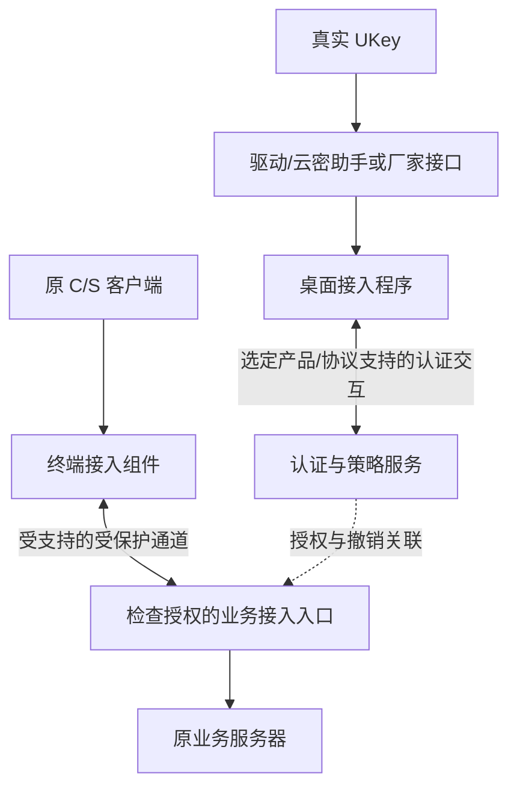

# C/S UKey 首版交付与实施计划 v0.1

日期：2026-11-06。状态：交付定义与开发计划，尚非已经实现的产品说明。

原生 C/S DEMO 已增强至 0.2.0，37 项测试及源码解压复测通过。二进制独立进程检查 15 项符合预期，2 项确认隔离缺口。REAL-PILOT、真实 UKey、国密通道和现场防绕行待验证。 [增强验证记录](../validation/cs-enhanced-validation-2026-11-06.md)

## 1. 已确定的交付目标

用户已确认首版限定一个真实 C/S 系统和一款 UKey。最终交付应满足：

> 接收方拿到源码、构建及安装包、配置模板、依赖清单和验收手册，在隔离测试网络中，准备清单所列的真实 UKey、证书、助手及密码组件后，可以完成指定 C/S 的认证接入、业务访问和故障验证，并生成可追溯结果。

原业务 EXE 和业务服务器程序不修改源码。安装配套软件、修改连接配置、调整防火墙及网络入口的许可仍需在选定试点中落实；不能由“不改源码”自动推导出这些变更都已获准。

**现有网页端按现状保留，C/S 作为独立接入链路交付。** 用户确认原网页现场流程没有前置网关。收到的网页插件源码包含 HTTP 代理能力，本地代理实验用于确认该能力，现场链路以用户确认和实际拓扑为准。原网页 JS、登录插件、登录入口、认证接口、助手版本及配置均保持现状。C/S 使用独立的服务端口、配置和授权策略。账号、证书和应用的映射按需只读导出，再导入 C/S 自己的配置。若两端共享业务服务器或密码组件，试点应先列清网页现有连接，C/S 的防绕行规则只限制约定的 C/S 直连路径。

“仿真生产”指部署、设备、网络隔离、身份和业务流程接近目标现场，使用测试账号及脱敏数据；不直接在生产系统上试验。

首版支持范围要精确到：业务客户端/服务端版本、操作系统与位数、UKey 型号/固件、驱动/助手、证书类型、密码服务版本和通道实现。未验证组合列为待验证，不扩大支持承诺。

## 2. 我们当前已经做到哪里

| 项目 | 当前状态 | 对后续工作的意义 |
|---|---|---|
| 公开厂商接入资料与第三方样本静态分析 | 已完成首轮，动态证据有限 | 支持“终端适配 + 认证授权 + 受控业务通道”的分层思路，不作为项目兼容性保证 |
| 网页 JS、部署手册和服务端源码分析 | 已完成 | 已知可复用的用户/证书配置、密码服务适配及 HTTP 代理实现 |
| 原插件本机构建与网页验证 | 已完成 | 原服务可运行；14 项观察包括正常功能与缺口复现，不是安全验收通过 |
| 真实 UKey/云密助手联调 | 未完成，当前没有可用硬件环境 | 必须早期安排设备及接口验证，不能全部留到交付前 |
| 原生 C/S 接入程序与受控连接 | DEMO 已实现并测试 | 软件证书、样例业务已运行；真实设备/协议和现场网络尚待接入 |
| 他人机器上的安装、跨机器测试与发行包 | DEMO 源码/二进制包已生成，换目录复测通过；跨机器待验证 | 旧网页验证脚本仍属于本机基线，产品入口另见 product/README.md |
| 目标系统适用指标与正式评估证据 | 未确定完整范围 | 工程测试结果与系统合规判定分别管理 |

依据：[源码分析](../research/ymnmr-source-analysis-2026-11-05.md)、[本地验证](../validation/web-ukey-local-validation-2026-11-06.md)、[厂商研究](../research/cs-ukey-integration-research-2026-11-02.md)、[第三方静态分析](../research/third-party-ukey-reverse-analysis-2026-11-03.md)。

## 3. 采用的工程组织方式

采用**一个 C/S 代码仓库，终端与服务端分别运行和发布**。当前 C/S 工程位于 `product/`，提供精确账号映射导入，使用独立的认证和授权入口。原网页沿用现有入口和认证流程。

后续组织目标如下；当前实际模块为 `product/common`、`product/access-server`、`product/desktop-agent`、`product/lab`，以产品 README 为准：

```text
cs-ukey-access/
  apps/
    access-server/           复用配置模型，提供 C/S 认证、授权和配置导入
    desktop-agent/           用户电脑上的配套接入程序
  modules/
    device-adapters/         云密助手或已选厂家 SDK 适配
    channel-adapters/        受支持的业务通道/接入产品适配
  lab/
    sample-cs-client/        原生 C/S 测试程序
    sample-business-server/  测试业务服务
    mock-ukey/               明确标识的软件替身
    mock-crypto/             明确标识的密码服务替身
  deploy/
    demo/                    无硬件复现配置
    real-pilot/              真实试点配置及环境检查
  tests/
    regression/
    acceptance/
  docs/
```

不把原样证据目录直接复制为产品源码。开发代码应有版本控制、构建入口、依赖锁定及变更记录，原材料继续保留用于对照。

## 4. 每个交付部件负责什么

| 部件 | 已有可复用内容 | 新增或完善内容 |
|---|---|---|
| C/S 认证与策略服务 | 账号、证书与应用的映射模型，密码服务接口资料 | 选定认证协议的完整实现、授权会话、应用/资源权限、撤销、管理认证与审计 |
| 桌面接入程序 | 可能复用云密助手；其接口尚待取得 | 选择应用/证书、发起认证、对接通道、显示状态、退出和故障处理、安装升级 |
| 业务接入入口 | 现有模块只提供 HTTP 代理 | 按目标协议检查授权、承接业务连接、限制资源、处理长连接和撤销 |
| 配置工具 | 管理平台界面见手册，完整源码未提供 | 至少提供可独立使用的试点配置工具、格式校验和发布说明，避免只能依赖老师手工配置 |
| 样例与测试工具 | 已有网页模拟验证 | 新增 C/S 客户端/服务端、正负向测试、环境诊断和报告生成 |

桌面程序可对接现有版本助手已提供的受支持接口。试点需要验证同一终端上网页与 C/S 交替使用 UKey 时的 PIN 状态、设备占用和退出行为。若接口不满足需求，C/S 使用独立适配方案，原网页助手按现状运行。

## 5. 必须分开的三个验收目标

1. **接入认证**：验证真实凭据及其授权，不能只检测 USB、序列号或本地 PIN 成功。
2. **业务访问控制**：未经认证或未获目标资源授权，无法通过接入入口建立业务连接，原路径也不能绕行。
3. **业务账号关联**：实际登录的业务账号处于该 UKey 身份的允许范围，并能关联最终业务会话。

账号映射表本身只能作为第 3 项的配置依据，不是执行结果。原系统有现成认证接口时优先复用；没有时需要经过验证的协议适配或其他受支持方式。若选定系统无法在约束下实现业务账号关联，应明确缺口、调整试点或范围，不能以“网络接入已通”代替完成该指标。

样例业务中自行增加认证检查，只能证明样例能力；不能作为未修改的第三方真实系统也支持该能力的证据。

## 6. 认证路径和业务路径



图中是逻辑职责，不要求采购同等数量的设备。接入入口可以是受支持产品，也可以是项目中的模块；密码认证、通道密码及证书能力应使用选定的受支持实现和 SDK，不自行发明密码协议。

授权要绑定到所选产品实际能够验证的用户和连接/会话。不能仅凭网页 Cookie、客户端自报用户名、启动 EXE、固定串号或放行终端 IP 作为全部授权依据。客户端开端口和客户端界面提示不能代替服务端执行检查。

若通道由接入产品直接完成 UKey 认证，应通过其受支持接口取得可验证的身份与授权结果；不要再把另一套布尔验签结果拼接成未经验证的认证协议。

首版建议优先挑选固定 TCP 端口、目标地址可配置的业务，降低接入变量。这是选型建议，尚不是已经确定的协议。若真实目标依赖 UDP、动态端口、多服务器、广播发现或固定地址，则必须在 G0 重新选择通道方案，不能直接套用本地端口转发。

## 7. 两种运行入口，共用适配边界

### DEMO：无硬件复现

- 提供原生 C/S 样例及完整受控访问流程，不仅是网页弹窗。
- 模拟助手、密码服务和测试业务清晰标注，使用测试身份和软件密钥。
- 有固定的成功/失败案例和自动结果文件。
- 用于开发回归、交接培训，不作为真实硬件或商密验证通过的证据。

### REAL-PILOT：真实依赖与仿真生产网络

- 使用支持矩阵中真实 UKey、证书、驱动/助手和密码服务。
- 使用指定原业务 C/S 测试实例，保持原业务程序不改源码。
- 启用选定通道、安全策略、信任链和资源权限，验证各段保护范围。
- 启动前检查配置与依赖；缺设备、缺证书、密码服务不可用、通道能力缺失时，应明确失败。
- **禁止因真实依赖失败而自动切到模拟助手、软件替身、HTTP 降级或全面放通。**
- 通过已实现并验证的适配器切换，不承诺对任意厂家仅修改配置即可支持。

## 8. 模拟生产环境需要怎样搭

至少设置终端侧与受保护业务侧两个逻辑网络，明确接入入口。可以用专用测试机和虚拟机部署，但要能够验证路径约束。

| 区域 | 部件 | 验证要点 |
|---|---|---|
| 终端侧 | 厂家支持的 Windows 测试环境、UKey、助手、Agent、原 C/S | 真实设备调用、终端权限、多用户、业务操作；虚拟机还需验证 USB 透传 |
| 接入服务侧 | 认证服务和接入入口，可按产品要求合并或分开 | 服务身份、会话授权、受保护通道、资源限制、撤销 |
| 业务侧 | 原业务测试服务、必要的数据库与其他依赖 | 仅允许约定的受控路径，核实业务登录与会话 |
| 密码服务侧 | 授权测试实例、信任根及状态服务 | 实际版本、证书用途、密码能力与失败行为 |

本机 localhost 演示不能证明跨机器路由、原地址绕行和网关后路径保护已完成。真实试点需做终端直连、备用地址、IPv4/IPv6、重连与长连接测试，范围以目标连接清单为准。

现阶段 Mac 继续承担开发和模拟测试；真实助手在哪个操作系统和位数可用，需要厂商资料及实机验证，不把 Mac 模拟通过当成 Windows 设备兼容结论。

## 9. 当前工作顺序及完成门槛

| 阶段 | 应做工作 | 交付物与完成条件 |
|---|---|---|
| G0 冻结试点组合 | 选定系统、UKey/证书、OS、密码服务；列全连接、业务账号目标、允许变更及性能指标 | 版本支持表、拓扑、连接清单、指标映射和试点配置；关键未知项有责任人 |
| G1 真实依赖探针 | 在厂商支持终端上枚举设备/证书、执行允许的密码操作、对接真实测试密码服务，核对通道方案 | 可重复的设备及服务联调记录；若助手/协议不适用，先解决适配路线 |
| G2 C/S 接入服务加固 | 在 C/S 工程内完善认证授权、应用隔离、访问检查和故障拒绝 | C/S 正常流程可用，非法证明和连接被拒绝，网页配置保持基线 |
| G3 C/S 样例与终端接入 | 实现 Agent、设备适配、通道适配、资源配置以及自带 C/S 样例 | 不依赖浏览器完成样例认证和受控业务连接，未授权连接被拒绝 |
| G4 真实组合联调 | 多机器部署，接真实 UKey 和原 C/S 测试实例，按矩阵做正负向、业务和故障测试 | 证据覆盖真实试点组合；业务账号关联和通道保护分别判断，不以模拟结果替代 |
| G5 接收方复现与发行 | 换干净环境，按手册安装、配置、测试、诊断、升级及回滚 | 接收方不用修改源码、查开发者电脑路径或口头补步骤即可复现；生成版本化发行包与验收报告 |

G1 的设备和厂商联调要与 G2/G3 的开发尽早并行。没有设备时可推进后端与样例，但 G1/G4 未通过就不能把 REAL-PILOT 标为完成。

G2 将原网页验证中观察到的未授权转发、证明重送和故障放行作为 C/S 的反例。C/S 入口应检查授权会话、凭据和资源的绑定，并按选定协议拒绝非法证明和连接。原网页的观察结果保留在基线报告中。

## 10. 实际要给接收方的包

1. **源码与构建入口**：固定版本、依赖清单/摘要、构建脚本、第三方组件和使用条件；能够在支持的干净环境构建。
2. **服务端发行包**：JAR/运行时或明确的版本前提、启动停止和服务安装脚本、配置模板、升级/回滚及备份恢复说明。容器方式可选，不作为唯一入口。
3. **终端发行包**：支持操作系统的安装包或明确的免安装包、所需助手/驱动说明、设备检测、日志导出、卸载和升级方式。不能只提供 Mac shell 脚本。
4. **DEMO 配套环境**：C/S 样例、业务服务、模拟器及测试数据，明确标注模拟性质。
5. **REAL-PILOT 适配与依赖表**：实际型号、版本、证书和密码服务配置说明；第三方依赖允许随包提供时才纳入，否则提供受支持的合法获取途径和版本校验，不暗中使用开发机缓存。
6. **诊断与验收工具**：检查进程、端口、证书/设备可用性、连通性和策略，输出脱敏报告、测试结果与版本信息。
7. **实施及运维手册**：拓扑、端口、安装、初始配置、证书生命周期、故障、长连接、退出、应急、恢复和验收步骤。
8. **支持与限制清单**：准确区分已验证、失败、未覆盖的组合和能力。

发行包不能含真实 PIN、私钥、生产服务凭据、固定默认配置密钥、开发者个人路径或无关日志。真实配置缺失时应报错；示例配置只含占位符或明确的测试值。

现有验证代码中的本机路径、绑定端口、浏览器依赖和只适用于 Mac 的工具准备，是需要工程化的项目，不能原样作为跨环境发行入口。

## 11. 验收与合规如何组织

详细用例见[首版验收矩阵](cs-ukey-pilot-acceptance-v0.1.md)。退出、UKey 拔出、会话过期、吊销、故障切换后的行为，以及性能、并发和恢复目标，要在 G0 定义；没有明确指标，就不能只凭“看起来能用”判通过。

工程验收覆盖：设备调用、身份与权限、强制路径、业务身份、通道保护、业务兼容、故障与生命周期、运维和接收方复现。

合规工作以目标系统适用指标、实际产品/版本、密钥与证书管理和客观证据为基础。UKey 型号、接口标准或使用签名机均不能单独给出完整系统结论。根据《商用密码应用安全性评估管理办法》第十、十一条，方案和系统评估涉及适用指标、产品服务使用、密钥管理、评估范围与客观凭据。[官方规定](https://oscca.gov.cn/sca/xxgk/2023-10/07/content_1061109.shtml)

## 12. 调研与逆向知识怎样落实到开发

| 已有依据 | 转化成工程要求 | 不作的扩大推断 |
|---|---|---|
| H3C 分别配置 Web、TCP、IP 接入 | 根据真实协议选择通道适配，认证与资源授权单独设计 | 不把现有 HTTP 页面代理认定为已支持全部 C/S |
| aTrust 明确调用厂家接口库，需匹配驱动、证书与接口 | 设备适配有明确版本/位数/证书用途和错误处理 | 不认为标准函数名相同就能适配全部 UKey |
| iSecSP 静态路径把 SKF 签名衔接到通信库 | 设备能力与通道认证需要受支持的接口边界，签名格式必须对齐 | 不把函数存在当作现场握手与算法已验证 |
| EasyConnect 历史样本由界面请求本机 Agent | UI、本地设备能力、接入连接分工明确 | 不复制历史 HTTP 参数形式为安全协议 |
| 远程应用发布、ESSO 等路线 | 仅在目标约束和必要性支持时作为备选 | 不默认采用 Hook、EXE 修改或凭据代填来解决一切 |

主来源：[H3C SSL VPN 配置](https://www.h3c.com/cn/d_202605/2848916_30005_0.htm)、[aTrust UKey 配置](https://bbs.sangfor.com.cn/atrustdeveloper/aTrustClient/docs/8.%E5%B8%B8%E8%A7%81%E9%85%8D%E7%BD%AE%E7%B1%BB%E9%97%AE%E9%A2%98/8.1ukey%E8%AF%81%E4%B9%A6%E8%AE%A4%E8%AF%81%E9%85%8D%E7%BD%AE.html)、[已有第三方样本证据](../research/third-party-ukey-reverse-analysis-2026-11-03.md)。

当前标准核对入口：[GM/T 0016-2023](https://std.samr.gov.cn/hb/search/stdHBDetailedCNF?id=1BF26B7A9FFBFD76E06397BE0A0A81D8)、[GM/T 0024-2023](https://std.samr.gov.cn/hb/search/stdHBDetailedCNF?id=1BF26B7AA003FD76E06397BE0A0A81D8)、[GB/T 43206-2023](https://std.samr.gov.cn/gb/search/gbDetailed?id=053404E3EF2D8F91E06397BE0A0A9209)。这些是适用性核验线索，不表示本项目已经满足所有条款。

## 13. 紧接着应推进的事项

一条线落实真实试点组合：取得 UKey/助手接口与设备、目标 C/S 测试安装包及连接资料、可用的密码服务和通道能力，确认安装与网络调整边界。

另一条线开发可独立交付的基础：建立产品开发目录和构建入口，把现有模拟验证改为可移植的回归工具，完善服务端认证与强制访问控制，并实现原生 C/S 样例和 Agent 的适配接口。设备相关操作不以模拟结果伪装完成。

完成这些工作后，交付状态才能从“当前网页验证工具”推进为“DEMO 可复现”，再推进为“指定真实组合 REAL-PILOT 已验证”。
