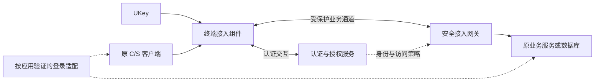

# C/S 无源码 UKey 接入设计草案 v0.1

更新日期：2026-11-06。状态：供方案讨论和技术验证使用，尚未形成项目合规结论。首版交付范围已确认限定一个 C/S 与 UKey 组合，具体型号和业务版本待确定；最新执行依据见[首版交付与实施计划](../delivery/cs-ukey-pilot-delivery-plan-v0.1.md)和[验收矩阵](../delivery/cs-ukey-pilot-acceptance-v0.1.md)。

## 1. 已确认条件与设计假设

已确认：业务系统不限行业，目前主要对象为医院、政府等单位；包含 C/S 客户端；不修改业务源码；需要满足项目适用的商用密码要求；网页端已经实现 UKey 接入。

新增证据：已收到网页部署手册、JS 和 `ym-login-plug:1.1.5` 源码，确认产品提供 HTTP 代理/脚本注入、账号与设备/证书配置及密码服务 SDK 调用；文档要求终端安装云密 UKey 助手。已完成本机网页软件替身验证，确认正常调用流程及认证授权缺口，尚未接真实 UKey。

未知：现场究竟采用代理注入还是原页面引入、实际运行版本、是否另有强制接入控制；UKey 型号、证书及用途、助手实现、C/S 技术栈、操作系统、连接协议、可用密码与通道设施、密改范围与等级。终端安装、网络与部署变更条件仍需在选定试点确认。

2026-11-03 条件纠正：用户明确“网页已有前置网关”仅是猜测。此前把它写成已确认条件的表述已撤回；下文网关复用路线均为有前提的候选，不能据此断定现网存在可复用网关。

本草案默认保留原业务程序及原有服务端认证逻辑。EXE 补丁、替换认证库、修改认证判断、生产进程注入均未纳入默认接入路线。用户提出 REA 的当前用途是研究第三方现有接入软件的实现，不是逆向用户自己的业务客户端；实际记录见 [第三方软件静态分析](../research/third-party-ukey-reverse-analysis-2026-11-03.md)。

## 2. 分别定义接入目标

| 目标 | 要得到的结果 | 不足以单独证明该结果的现象 |
| --- | --- | --- |
| 接入身份认证 | 持有受信任凭据并获授权的主体，才能建立目标业务连接 | 检测到 USB 设备或读取到证书名称 |
| 业务身份关联 | 接入身份、被允许使用的业务账号与实际业务会话可靠关联 | 自动填写了用户名密码，或维护了账号映射表 |
| 通信保护 | 适用范围内的链路得到要求的机密性、完整性等保护 | 终端到网关已加密，但未说明网关后的路径 |
| 其他密码应用 | 按适用指标处理存储、日志、签名等要求 | 安装 UKey 或配置 VPN |

接入阶段可分别验收，但项目最终结论必须回到适用指标。某项未实现时，应保留缺口和处理措施。

## 3. 候选架构及职责



图中的逻辑职责可以由同一产品实现，不能据此要求采购同等数量的独立设备。网关至业务端的保护方式应按范围补充。登录适配的两个虚线表示候选接入点，不表示当前已实现业务集成。

| 职责 | 可复用内容 | 待具体项目确定的内容 |
| --- | --- | --- |
| UKey 适配 | 统一设备能力、证书枚举、签名及错误结果接口 | 厂家 SDK、接口版本、算法、位数及平台支持 |
| 认证与授权 | 证书身份校验、用户及应用权限、会话生命周期 | 信任根、证书来源、状态服务、密钥使用与产品边界 |
| 业务登录适配 | 应用和版本清单、模板分发、失败检测 | 已有接口、界面、命令行、协议解析或应用发布方式 |
| 业务连接控制 | 将访问权限限制到指定资源和连接 | 流量接管、动态端口、内网直连与多用户隔离 |
| 通信保护 | 统一配置与状态管理 | 实际产品、标准协议、保护起止点及后端路径 |
| 审计与运维 | 将证书、用户、应用、账号、会话和策略记录关联 | 日志接口、留存要求、保护措施、续期与应急流程 |

密码认证与通道使用选定产品支持的标准能力。上图描述逻辑职责，不是另行设计一套自定义密码协议。

## 4. UKey 型号未知时先确定接口边界

暂按四类能力定义设备适配接口：查询能力、列举可用证书、按明确用途请求签名、报告设备状态与错误。实现时映射到经核验的厂家接口；不能承诺任意品牌均支持全部能力。

证书识别与人员身份分开管理。证书续期、补发可能改变证书标识，人员身份及其授权应有明确的延续和回收流程。同一人员可按授权使用多个业务账号，不能强制简化成所有系统全局一对一。

UKey 设备序列号只作为资产或设备识别线索；是否持有相应私钥，需要真实密码认证证明。具体算法与证书用途以设备、产品及方案核验结果为准。

标准接口依据之一为现行 [GM/T 0016-2023](https://std.samr.gov.cn/hb/search/stdHBDetailedCNF?id=1BF26B7A9FFBFD76E06397BE0A0A81D8)；标准存在不代表当前未知设备已支持，也不代表任意 SDK 调用已被验证合规。

## 5. 业务适配的选择顺序

1. 检查原系统已有的身份接口、证书认证、单点登录或受支持启动方式；已经具备能力时优先复用。
2. 评估界面或命令行适配。成功输入凭据只是登录自动化证据；还要验证账号选择、凭据保护、失败、改密及人工换号。
3. 评估受支持的协议解析与账号匹配。需要真正识别相关登录与会话，不能仅凭源 IP 推断业务用户；私有或应用层加密协议保留待验证状态。
4. 如果允许改变运行位置，评估远程应用发布；验证外设、文件、打印、多会话和授权。
5. 上述证据不足时，再用 REA 对选定样本进行聚焦分析，寻找可用接入点。仍无法实现强制身份关联时，记录缺口并调整项目措施或约束。

公开机制先例与版本限制见 [调研记录](../research/cs-ukey-integration-research-2026-11-02.md)。

## 6. 必须明确的连接与会话边界

仅按终端 IP 放行时，需评估同机其他程序、其他操作系统用户、共享桌面会话和本机代理是否也获得访问。终端进程与系统用户身份不能直接等同于业务账号。

如果选用 Windows，WFP 的 ALE 提供按应用及系统用户身份过滤的机制，可作为终端连接控制的技术依据；它本身不解析业务账号，也不是业务密码身份鉴别的完成证明。[微软 ALE 文档](https://learn.microsoft.com/en-us/windows/win32/fwp/application-layer-enforcement--ale-)

需要形成会话事件的处理表：用户退出、切换人员、UKey 拔出、证书失效或吊销、终端组件退出、网关切换和业务长连接断开。每种事件明确是否阻止新连接、是否终止已有连接、如何通知业务用户及如何审计。不能假设拔出 UKey 会自动撤销所有已建立的业务会话。

用户到目标业务的直接路径、备用地址、IPv4/IPv6、动态端口以及自动化接口均需要纳入连接清单。人工作业与机器接口分别定义身份和策略。

## 7. 合规与运行边界

法律适用范围、指标、选型证明、实际使用条件、密钥与证书管理，以及实施证据需纳入密码应用方案。不能预先以产品宣传或逆向分析结果代替系统评估。[密评管理办法](https://oscca.gov.cn/sca/xxgk/2023-10/07/content_1061109.shtml)

首轮方案应列出可复用产品、自研组件、第三方服务及各自承担的密码功能。产品认证核验应对应实际型号、版本和部署方式；自研集成部分的实际能力与适用要求也需验证。

采用串行网关时验证容量、延迟和故障切换。采用旁路认证时，必须另行说明流量保护与访问强制措施。二者不是同一保护范围。[厂商部署方式示例](https://www.infosec.com.cn/default/index/product_detial/71)

应急访问明确身份、资源范围、时限及审计，不默认在认证故障时全面放通。具体响应时间、可接受中断和恢复目标按实际业务确定。

## 8. 第一轮验证的完成条件

| 验证项 | 通过所需证据 |
| --- | --- |
| 程序识别 | 样本、版本、哈希、运行时与检查覆盖范围记录 |
| 连接识别 | 登录及代表性业务操作的完整连接与依赖清单，标注未覆盖范围 |
| UKey 认证 | 对受信任、未授权、无效或失效凭据的实际结果；保留验证配置与记录 |
| 强制访问 | 未认证、未授权及原路径直连测试的结果；标注豁免连接 |
| 业务身份关联 | 正确账号成功；未经授权的账号选择或替换被有效拒绝，且能关联实际会话 |
| 人员与会话切换 | 退出、切换、拔出等事件达到方案定义的行为，避免沿用前一人员权限 |
| 兼容与连续运行 | 核心业务操作、重连、升级、故障切换及回退的测试记录 |
| 保护范围 | 每段链路的保护机制和检查结果，其他密码指标的覆盖或缺口清单 |

每项标记为“已验证通过／已验证未通过／待验证”。文档声称支持某能力，不能直接标记为通过。

## 9. 当前可推进工作

已完成网页源码与本机构建、软件替身验证。当前应冻结首版真实 C/S/UKey 组合，尽早验证助手与密码服务接口，同时完善现有服务端认证授权、开发原生 C/S 样例及终端/通道适配。可移植交付、真实依赖验证及接收方复现分别设完成门槛，具体见最新交付计划；不把已有网页模拟结果标为真实 C/S 接入通过。

## 10. 已有网页端接入与 C/S 接入的比较

2026-11-03 用户澄清网页端前置网关、代理方式仅是猜测。此后收到的产品源码已确认 HTTP 代理/JS 注入能力和本地服务调用，部署手册还提供原 HTML 引入方式；现场实际部署仍未知。以下保留为不同接入方式的分支比较，不代替最新源码和联调证据。

### 10.1 相同的认证目标与有条件的复用

如果现有网页端采用数字证书密码认证，两种形态都需要调用设备中的密钥证明持有关系，校验受信任身份和授权，再将结果关联到业务访问。PIN、私钥、证书、认证结果和业务会话具有不同职责。

| 现有能力 | C/S 复用判断 | 复用前提 |
| --- | --- | --- |
| UKey、证书、驱动及厂家接口 | 优先核验复用 | 平台、算法、证书用途、授权及使用条件匹配 |
| 证书校验、验签与状态服务 | 优先核验复用 | 已有标准认证能力允许新接入方使用，参数和用途一致 |
| 用户目录与证书身份关联 | 可以延续人员身份模型 | 新业务的账号及权限另行配置，不自动继承全部访问权限 |
| 审计、续期、吊销和运维流程 | 可以扩展 | 加入 C/S 应用、实际业务账号、会话及终端信息 |
| 网页 JavaScript、页面控件和 Cookie | 需评估替换或封装 | 原 C/S 程序不会因外部认证成功而自动理解网页状态 |
| 网关或代理设备 | 按具体能力判断 | 资源发布协议、部署模式、容量及产品使用条件覆盖目标 C/S |

网页也可能通过浏览器证书能力和系统驱动认证，不一定存在可直接调用的独立本地 HTTP 服务。因此要先确认现有调用链，再判断终端组件能否复用。

### 10.2 候选模式：网页登录逻辑集成认证服务

```text
网页调用设备能力 → UKey 完成密码运算 → 认证服务验证 → 业务服务建立会话
```

这种模式下，可复用性主要位于设备支持、密码认证和身份管理。C/S 不改源码时，新增组件即使取得平台认证结果，原业务服务也未必接受它；需要已有认证接口或有效的外部适配。不能直接复制浏览器 Cookie 或把启动器放行当作原业务身份已确认。

### 10.3 候选模式：网页通过前置网关或代理接入

```text
浏览器 → UKey 认证网关 → Web 代理或单点登录适配 → 原网页系统
```

这种模式下，可复用性主要位于认证入口、证书体系、策略平台及部分网关设施。新增 C/S 时要分别检查业务流量承接和账号登录适配。仅处理 HTTP 的代理不能凭网页配置直接覆盖任意 TCP/UDP 私有协议。

需先确认是否存在这类网关，再核验认证调用、账号关联、会话机制和具体协议支持。

### 10.4 关键差异与验证

| 维度 | 网页常见形态 | C/S 需要重点确认 |
| --- | --- | --- |
| 访问协议 | HTTP/HTTPS，存在 URL、请求和响应 | 可能仍是 HTTP，也可能是其他 TCP/UDP 或数据库连接 |
| 登录状态 | Cookie、令牌、服务端会话等 | 可能是私有令牌、长连接、数据库会话或本地状态 |
| 外部自动化 | 可检查页面及表单，仍有自定义控件等限制 | 界面技术栈、控件可访问性、命令行和现有接口差异 |
| 身份强制 | 需要服务端或网关验证并防止旧入口绕行 | 同样需要强制控制，并处理进程、多用户及长连接 |
| 兼容与维护 | 浏览器、页面及本地组件版本 | 原客户端、驱动、终端组件、协议及应用版本 |

C/S 是运行形态，不能据此判定一定采用私有协议。若它与网页共享已有认证及业务接口，复用条件可能较好；反之，即使界面类似网页，也不能假定其会话可共用。

下一步优先从已经成功的网页端取得非敏感的调用链和材料：安装包/驱动厂商信息、前端或网关配置、认证接口说明、身份到业务账号的关联方式、已有评估范围。未知型号可从这些材料逐步识别，无需先凭记忆提供型号。

具体询问与收集方式见 [老师访谈与资料收集清单](../intake/teacher-interview-web-ukey-to-cs-2026-11-04.md)，按六组网页/目标信息及两组 C/S/实施边界信息组织，不预设已有前置网关。

复用时逐项确认新增 C/S 是否在原方案和评估范围、实际部署及使用条件是否改变；Web 接入成功本身不能扩大评估结论的覆盖范围。实际评估以系统边界及客观证据判定。[密评管理办法第十一条](https://oscca.gov.cn/sca/xxgk/2023-10/07/content_1061109.shtml)

## 11. 若确认已有前置网关，可评估的复用路线

### 11.1 门户认证与 C/S 通道分别处理

本节前提尚未证实：网页方案确实存在可集成的认证入口及配套接入能力。满足前提后，可评估保留网页 UKey 认证入口，由配套接入组件取得受控的客户端访问权限，再建立 C/S 业务通道。原 C/S 程序不一定需要直接调用 UKey。

```text
认证过程：浏览器 → 现有 UKey 认证入口 → 已认证的门户会话
                                      ↓
                          受支持的客户端授权或认证机制
                                      ↓
业务过程：原 C/S 客户端 → 接入组件 → 受保护通道 → 接入网关 → 原业务端
```

关键前提是网关或所增加的组件确实支持门户与客户端会话关联。若不支持，另一候选是由配套客户端重新执行受支持的证书认证，并核验能否复用现有密码与身份服务。不能自行把“浏览器已登录”、本机 Cookie 或源 IP 当成充分的客户端授权证明。

公开模式依据：[H3C SSL VPN 配置指导](https://www.h3c.com/cn/d_202605/2848916_30005_0.htm)包含用户在浏览器登录后启动 TCP 接入程序的例子，可证明门户与 TCP 接入组合是实际产品路线。该例子不能直接证明现有网关具备同等能力，也不能替代本项目对国密算法、证书与产品使用条件的验证。

### 11.2 需要分别验证的三个身份关联

| 关联 | 要证明的事实 | 主要验证点 |
| --- | --- | --- |
| UKey 身份到门户用户 | 认证组件识别了正确的受信任主体 | 核实实际认证机制、证书来源和授权；先确认认证组件的实际部署 |
| 门户用户到客户端通道 | 获授权的接入组件代表同一用户访问特定资源 | 会话交接或重新认证、资源范围、重放与退出行为、同机多用户 |
| 客户端通道到业务账号 | 实际业务账号在该身份的授权范围内 | 已有接口、协议适配或受控运行；换号、重连和长连接验证 |

三个关联应分别记录证据。只有前两项成立时，业务账号关联仍可能有缺口。

### 11.3 按通信机制选择流量接入

| C/S 实际连接机制 | 优先评估方式 | 关键前提 |
| --- | --- | --- |
| HTTP/HTTPS | 核验是否有可复用的 Web 代理，或其他已有接入接口 | 先确认实际部署；地址、认证交互、会话及原有证书校验均需兼容，不能只凭同为 HTTP 判定可用 |
| 少量固定 TCP 端口 | 受支持的 TCP 代理或本地端口映射 | 可通过配置接入，或具备可靠的流量引导能力；保持原协议所需的身份与证书校验 |
| UDP、多端口、动态端口或多服务依赖 | 按资源限定的 IP 隧道或相应代理 | 协议、路由、DNS、回程与访问控制均覆盖；广播发现等特殊依赖单独验证 |
| 无法适配本地运行，且允许迁移运行位置 | 远程应用发布 | 业务体验、外设、文件、授权、多会话及账号托管经过验证 |

### 11.4 按网关是否存在及其能力决定工作量

| 查明后的结果 | 对应工作 |
| --- | --- |
| 无前置网关，或尚未证实存在 | 先识别网页实际认证组件，评估可复用服务；独立论证 C/S 是否需要外置接入组件和网关 |
| 已支持 C/S 接入、客户端身份认证及相应策略 | 先做应用资源配置、业务账号适配和验证，再评估是否需要新增组件 |
| 只支持 HTTP 反向代理，但有受支持的认证集成能力 | 评估新增 C/S 接入组件或配套网关，复用身份服务并验证跨组件关联 |
| 网关协议、集成接口或产品使用条件不满足 | 单列缺口及替代架构，核验适用的密码产品、协议和评估要求 |

网关是否存在、来源及能力均未确认；以上分支不依赖预先认定现网部署，但不能据此确定配置命令、产品型号或开发接口。第一轮先识别网页实际方案，并验证一套 C/S 客户端的业务协议、身份关联和不可绕过性，再据实扩展支持范围。

## 12. UKey 调用、认证与 C/S 接入操作

本节将第三方软件中的静态发现收敛为候选实施流程，不代表当前产品已支持。原业务源码保持不变，UKey 调用由配套终端组件承担。若现有产品已经实现这些能力，优先配置和复用；以下逻辑职责不要求重新开发或分别部署。

### 12.1 接入前的配置

1. 核验 UKey、证书及其用途，选择实际支持的平台、位数、SKF 接口库或其他厂家接口。SKF 标准接口不等于所有型号自动兼容；并非所有证书都能用于目标认证协议。
2. 在认证端配置受信任 CA、证书校验与状态检查方式、允许的认证参数，以及证书身份到内部用户的受控关联。不要用客户端提交的姓名、设备序列号或未验证的证书显示名直接授予身份。
3. 给内部用户配置 C/S 业务资源权限，明确目标地址、协议及端口；业务账号关联另行配置，不能把资源权限表当成业务登录适配已完成。
4. 确定原 C/S 连接如何经过接入网关，并控制可绕过的直连路径。终端组件安装及网络策略变更仍以具体项目条件为准。

### 12.2 一次典型登录的调用点

| 步骤 | 执行方 | 操作或候选接口 | 成功结果 |
| --- | --- | --- | --- |
| 查找设备 | 终端接入组件 → 厂家库 | SKF_EnumDev、SKF_ConnectDev | 取得有效设备连接 |
| 选择认证凭据 | 终端组件 → 厂家库 | SKF_EnumApplication、SKF_OpenApplication、SKF_EnumContainer、SKF_OpenContainer、SKF_ExportCertificate，具体顺序依设备权限和 SDK 而定 | 选中与本次认证用途匹配的证书及密钥容器 |
| 建立可信认证交互 | 终端组件 ↔ 认证端 | 使用产品支持的证书认证机制，校验服务端身份 | 客户端知道正与受信任服务交互 |
| 本地使用授权 | 用户、终端组件、UKey | 按产品交互输入 PIN；调用 SKF_VerifyPIN 或受支持的等效机制 | 取得相应设备操作权限，不据此直接授予业务访问 |
| 证明持有对应密钥 | 终端密码协议组件 → 厂家库 → UKey | 按认证协议请求签名，例如 SKF_ECCSignData | 得到与当前认证交互对应的密码证明 |
| 验证身份并授权 | 认证端／网关 | 校验证书信任链、有效期、用途及适用状态检查；验证密码证明，并匹配内部用户及资源权限 | 产生受控访问会话，或拒绝认证 |
| 建立 C/S 访问 | 终端组件 ↔ 接入网关 | 按产品机制将授权会话关联到受保护业务连接 | 允许该主体访问已授权的资源 |
| 业务登录 | 原 C/S 客户端、原业务服务及可选适配 | 保留原登录，或使用已有身份接口、经验证的登录适配 | 实际业务账号及会话符合项目身份关联目标 |

表中的“应用”和“容器”指 UKey 内部的逻辑对象，不是启动业务 EXE。证书发现是否要求 PIN、PIN 出现的位置及重复使用规则由设备、SDK 和产品机制确定；不能把表格固定成对所有型号适用的 API 调用脚本。

签名输入、摘要处理、算法参数及输出编码必须由选定协议与 SDK 按规范完成。表格解释的是设备调用点，不是在定义一套“签随机数即登录”的自制认证协议；重放防护及会话关联需由所选认证机制落实。

PIN 在本地设备操作中按产品机制保护，不作为原业务账号密码提交，不写入普通日志；私钥签名路径使用设备接口，不需要导出私钥。结束和异常时按 SDK 规则关闭容器、应用和设备句柄。

### 12.3 复用网页入口时的两条分支

本节先要求查明网页实际认证组件及接口，尚不能认定已有网关；若实际为业务代码、浏览器能力或本地组件集成，按相应接口另行判断复用条件。

- 网关支持门户到接入客户端的授权交接：沿用现有网页 UKey 认证，再通过产品明确支持的机制授权终端组件建立 C/S 通道。此时不能再无条件要求终端组件重复验 PIN、重复签名；是否重新认证由产品策略决定。
- 网关不支持交接，但提供受支持的客户端证书认证：由接入客户端执行上述认证交互，核验能否复用现有 CA、用户目录、校验服务及审计平台。网页 Cookie、本机 IP 或一个“登录成功”标志不能自行替代通道认证。

如果网关只有 HTTP 反向代理能力，以上任一身份分支都不能自动增加其 TCP/UDP 承接能力，仍需第 11.3 节的流量接入方案。

### 12.4 失败、撤销和审计

| 事件 | 需要落实的操作 |
| --- | --- |
| 无设备、无合适证书、接口库加载失败 | 不进入授权访问；提示具体故障，不自动切换为无认证放行 |
| PIN 错误 | 显示设备返回的错误及适用重试信息，不自动循环尝试 PIN |
| 证书、密码证明或用户权限校验失败 | 认证端拒绝建立访问会话；记录可关联的失败原因 |
| 用户退出、Key 拔出或会话到期 | 按明确策略撤销访问，分别规定新连接、已有隧道及业务长连接如何处理；对撤销失败保留可见状态 |
| 证书到期、吊销或权限回收 | 按系统定义的检查时机、重新验证与撤销机制处理，不能假设已建立会话自动失效 |

审计至少需要能关联内部用户、证书身份、终端接入会话、被访问的应用资源及结果；需要业务身份关联时继续记录实际业务账号。证书续期和补发与内部人员身份的延续关系应受控维护。

以上流程可以先形成设备适配边界和产品能力核验表。实际 SDK 路径、调用参数、网关协议及配置命令，仍需从现有安装包、产品配置与接口文档取得，不能从未知型号推定。
