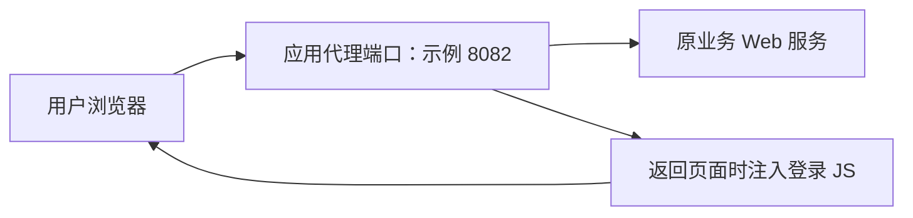

# 登录安全性插件 V1.1.4 与网页 JS 对照分析

分析日期：2026-11-05。

后续补充：已收到 `ymnmr-master.zip`，项目版本为 `ym-login-plug:1.1.5`。源码确认了 HTTP 代理及账号/证书查找，同时发现挑战生命周期和后续业务授权检查的缺口。见[服务端源码分析](ymnmr-source-analysis-2026-11-05.md)。本报告保留收到部署手册时的证据边界，不能把手册版本直接等同于现场运行版本。

## 1. 材料和证据范围

- [部署手册原样快照，11 页](/Users/chen/project/cs-ukey/artifacts/user-provided/2026-11-05/login-security-plugin-deployment-v1.1.4.pdf)
- [用户提供的 JS 原样快照](/Users/chen/project/cs-ukey/artifacts/user-provided/2026-11-05/main-interceptor-all.js)
- [PDF 来源及哈希记录](/Users/chen/project/cs-ukey/evidence/user-provided/2026-11-05/login-security-plugin-deployment-v1.1.4/manifest.json)
- [按 PDF 页码提取的文本](/Users/chen/project/cs-ukey/evidence/user-provided/2026-11-05/login-security-plugin-deployment-v1.1.4/pages.json)
- [先前的 JS 逐项分析](main-interceptor-all-analysis-2026-11-05.md)

已提取全 11 页文本、渲染全 11 页并检查页面及关键截图。未执行文档中的部署命令，未安装助手或 JAR，未连接任何文档或代码中的接口。

材料能够说明这套产品的设计和部署方式，但尚未确认用户项目现场采用哪一种方式、是否运行同一版本。PDF 第 7 页的 JS 配置截图与用户提供文件的关键配置相符，但不能据此证明完整代码完全一致。

## 2. 新材料确认了什么

| 前一个问题 | 现在得到的材料证据 | 证据边界 |
|---|---|---|
| 用户电脑是否需要软件 | 第 2 页明确要求安装并正常运行“云密 UKey 助手”MSI | 安装包未提供；内部驱动、接口库、兼容设备、监听端口未验证 |
| 服务端是什么程序 | 第 2—3 页要求部署 `ym-login-plug-xxx.jar`，默认服务端口 9191 | 具体 JAR 及源码未提供，不能确认内部强制校验逻辑 |
| 谁配置应用和用户 | 第 4—5 页由密码改造/免改造管理系统维护平台应用、UKey 用户并发布配置 | 管理平台和插件之间的完整接口及身份校验未知 |
| 是否支持代理注入 | 第 6 页 6.1 明确给出“通过代理端口登录”，截图示例 8082，返回页面注入 JS | 证明产品有这一接入模式，不证明所有现场已经采用，更不等同于已有通用 TCP/IP 接入网关 |
| 是否也能直接改原页面 | 第 6 页 6.2 明确要求在原登录 HTML 的 `body` 结束前引入 JS | 确实需要修改 HTML；若项目禁止改任何页面文件，此路线不满足该约束 |
| 认证 API 怎样访问 | 第 1 页更新说明提到通过代理端口访问；第 6—7 页还给出 `/login-plug-api` 加 Nginx 反向代理及直连 9191 示例 | 材料包含多种路径及历史示例，现场最终入口需要以实际配置为准 |
| 验签、随机数用什么能力 | 第 4 页允许配置签名机或加密机；第 10 页有调用密码服务的故障日志 | 仅确认设计选项与示例请求，不能证明现场硬件型号、算法、成功调用或系统合规性 |

## 3. “插件”在这里指什么

文档把部署在服务器的 `ym-login-plug-xxx.jar` 称为“登录安全性用户插件”。这是 Java 服务，不是已经证明存在的 Chrome 扩展。

用户电脑安装的是另一个交付物“云密 UKey 助手”；浏览器运行的又是 `main-interceptor-all.js`。三者要区分：

| 交付物 | 运行位置 | 职责 |
|---|---|---|
| 云密 UKey 助手（MSI） | 用户登录电脑 | 文档要求的 UKey 辅助软件，需要运行；内部实现未见 |
| `main-interceptor-all.js` | 浏览器页面 | 识别登录动作、收集 PIN、请求本地操作、请求验签、继续原登录 |
| `ym-login-plug-xxx.jar` | 客户服务器或文档所述的集中部署位置 | 登录插件服务，默认端口 9191；代理方式还会提供应用代理端口 |
| 密码改造/免改造管理系统 | 管理端 | 配置应用、用户及规则，将配置发布给插件 |
| 密码服务平台、签名机/加密机 | 服务端密码能力所在位置 | 按文档配置提供随机数、验签能力；实际链路和设备待核实 |

JS 访问 `127.0.0.1:38080` 的三个 `/sys/*` 接口。结合文档，可以推测“云密 UKey 助手”承担这段本地服务功能，但 PDF 没有明确给出 38080 的进程归属，需要安装包、接口文档或测试机监听信息确认。不能仅凭软件名称认定它就是某个 UKey 厂商的 SKF 库。

## 4. 两种网页部署方式

### 方式一：通过代理端口登录

文档第 6 页的流程是：部署 JAR、配置应用与 UKey 用户、发布，再使用代理端口打开业务登录页面。示例代理端口是 8082，9191 是插件服务的默认端口，二者不是一个概念。

该路线通过返回页面注入脚本，文档未要求编辑原业务 HTML，符合“不编辑原业务源码”的候选方向。但改变业务入口、证书和网络策略是否允许，以及原入口是否可绕过，仍需现场确认。

### 方式二：使用原登录页面

文档第 6—7 页要求修改原登录 HTML，引入 JS，并调整 `baseUrl`、登录接口和页面元素规则。认证 API 可以经 `/login-plug-api` 转到插件服务；也给出了直接访问插件地址的示例。

此方式可以不修改业务登录逻辑，但仍修改了页面文件。应按用户项目的“不改源码”具体边界判断，不能因为产品名称包含“免改造”就当作完全没有修改。

## 5. 运行时的认证链路

结合文档与 JS，正常路径可描述为：

1. 管理平台将平台应用规则、需要 UKey 的业务账号等配置发布给插件，生成 `config/platformConfig.json`（手册第 5 页）。
2. 浏览器通过上述一种方式加载登录 JS。
3. JS 调用 `/verifyUser` 判断当前业务账号是否需要 UKey。
4. 需要时收集 PIN，请求本地 `/sys/verifyPin`，再获取设备序列号。
5. 从插件 `/genRandom` 取得随机文本，并请求本地 `/sys/signwithpid` 签名。
6. 将签名、随机文本、序列号和账号发给 `/verifySign`。
7. 服务端验证路径按文档配置可调用签名机/加密机相关服务；其完整实现未提供。
8. JS 收到成功结果后继续原业务登录。该步骤不等于已证明服务端把 UKey 身份绑定到最终业务会话。

手册第 7 页写“默认 PIN 为 111111”，说明文档给出了默认使用说明。它不改变先前代码结论：JS 的 `setPin("111111")` 本身不做真实 PIN 比较，实际仍调用本地接口；实际设备 PIN 是否已修改未知。

## 6. 谁应当干哪些活

以下是按现有交付物划分的建议职责，不是对产品作者或合同分工的认定。

| 角色 | 需要负责的工作 |
|---|---|
| UKey 与助手维护方 | 提供设备及证书使用说明、MSI、必要的驱动/接口库、`/sys/*` 接口说明，解释本地权限及设备会话行为 |
| 现有插件/管理平台开发方 | 提供 JAR、配置发布接口、账号与证书绑定、随机数生命周期、验签及后端强制控制实现 |
| 你们 C/S 接入开发人员 | 先验证助手和认证接口能否复用；补齐桌面接入程序，以及认证结果与业务访问/会话的关联 |
| 实施人员与客户 IT | 按允许范围下发软件、部署服务、配置入口及网络策略、维护证书，安排业务验证 |
| 业务系统维护方 | 提供 C/S 连接方式、依赖服务、可配置的认证接口和允许调整的范围，配合验证业务身份和流程 |
| 最终用户 | 插入 UKey、输入本人 PIN、按配置使用业务；不需要安装开发环境或整套开发 SDK |

## 7. 对 C/S 的判断怎样变化

现在有了具体的复用目标：本地助手、服务端插件、管理配置和密码服务，不必再只讨论抽象的 Agent 或网关。

不过，现有资料展示的是 HTTP 页面代理与浏览器注入，没有展示普通 C/S 的 TCP/UDP/IP 代理、隧道或业务客户端认证适配。不能因为已有“代理端口”就认定它能代理任意 C/S 协议。

建议把下一阶段分成两项验证：

1. **认证能力验证**：在授权测试环境中，用一个最小桌面程序调用现有助手与服务端接口，确认不用浏览器时能否完成认证。这里只验证接口复用，不把它当作完整接入方案。
2. **业务访问控制验证**：明确认证后怎样允许指定业务连接、禁止未认证连接，并把认证结果绑定到对应用户和连接/业务会话。若只是弹出 UKey 窗口再启动原 EXE，仍不能证明业务访问受到强制保护。

如果原 C/S 已支持可配置的外部认证，优先验证该能力；如果没有，再按其协议和现场允许的变更评估外部安全接入、代理或隧道。网页中识别按钮和输入框的办法不能直接控制普通原生 C/S。

## 8. PDF 没有消除的关键问题

- **后端强制控制**：仍需查看原登录接口或代理是否要求有效认证结果，如何防止绕过、串账号、跨会话和重放。
- **JS 的故障放行分支**：用户提供的 JS 在 `/verifyUser` 异常、未找到账号输入框时继续原登录；部署手册没有给出独立的强制拦截证明。
- **本地服务边界**：38080 的进程归属、调用方限制、PIN 和设备会话保持、多用户/多 UKey 行为没有说明。
- **配置发布限制**：第 3 页样例为 `server.ips=*`，该参数描述的是哪些管理系统 IP 可以发布配置，不是业务用户访问白名单。其他发布认证措施及生产配置未知。
- **实际版本与运行环境**：手册标题 V1.1.4，但部分截图为 JAR 1.1.2；环境文字写 JDK ≥1.8，日志截图显示 Java 17。应以实际 JAR 和支持说明确认，不据截图直接给出兼容承诺。
- **接口入口**：直连 9191、应用代理端口、Nginx `/login-plug-api` 都出现在材料中；需要获取现场实际地址和配置，不能直接套用任一示例。
- **合规范围**：配置项出现签名机、加密机不等于已证明算法、设备证书、密钥管理及系统应用方式满足项目验收要求；现有材料不足以下完整合规结论。

## 9. 现在最该向老师要的材料

> 老师，这份文档里的云密 UKey 助手安装包和接口说明、`ym-login-plug` 的实际版本包或源码、发布出来的应用配置能不能给我看看？我想先确认不用浏览器时能不能复用现有认证，再看看验签成功后，服务端是怎么限制业务登录和访问的。另外，咱们现场实际用的是代理端口那种，还是改原登录 HTML 那种？

配置和日志只需提供能说明架构和调用关系的脱敏内容；不需要真实 PIN、私钥或生产访问凭据。
