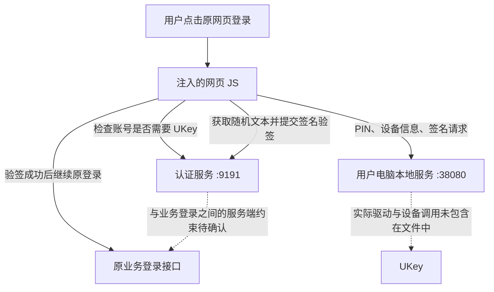

# main-interceptor-all.js 静态分析

分析日期：2026-11-05。用户提供的文件共 1,529 行、53,044 字节。

- [原样源码快照](/Users/chen/project/cs-ukey/artifacts/user-provided/2026-11-05/main-interceptor-all.js)
- [来源、SHA-256 与检查记录](/Users/chen/project/cs-ukey/evidence/user-provided/2026-11-05/main-interceptor-all/manifest.json)
- SHA-256：`95417d534c8ea2cb34dcbc40d050ce7eaf7fd1ff8bd2ffcafd5152b3eb0548ed`

本次只阅读源代码，并执行 `node --check` 语法检查，检查通过。没有执行脚本，没有访问其中的本地或远端接口，没有使用真实 UKey。尚未确认该文件是否为用户项目的线上版本，也未确认作者、产品厂家或部署方式。

后续补充：同日收到配套部署 PDF，文档明确了“云密 UKey 助手”、服务器 JAR 和两种网页部署方式。见[部署手册与 JS 对照分析](login-security-plugin-deployment-cross-analysis-2026-11-05.md)。本报告中“未包含在 JS 内”的判断仍成立；辅助服务端口归属、后端强制控制和现场实际部署方式仍需核实。

进一步补充：服务端源码包已到，证书来自发布配置里的 `UkeyUser.ukeyCert`。插件自身未实现一次性挑战管理，也未在代理转发前检查 UKey 登录授权。见[服务端源码分析](ymnmr-source-analysis-2026-11-05.md)。这些结论限于收到的源码，现场是否存在额外控制仍需确认。

## 1. 这个文件做什么

这是一个在浏览器页面中运行的登录拦截脚本。它的目标是：识别原业务登录动作，按账号判断是否需要 UKey；需要时显示 PIN 窗口，通过本地 HTTP 服务验证 PIN、请求签名，再请求服务端验签，成功后继续原来的业务登录。

它包含网页界面、浏览器请求和事件拦截、HTTP 接口调用。文件没有直接加载 DLL，也没有 SKF、PKCS#11 或 CryptoAPI 的实际调用代码。本地服务如何访问硬件、使用何种密码算法，需要另外分析本地程序。

文件开头注释声称“由后端 loadJavaScript 注入，并替换模板变量”，但文件里没有该后端方法的实现，当前参数也是具体字面值。因此：可以确认其设计意图是被注入页面；不能仅凭注释确认线上使用反向代理或前置网关。

## 2. 代码分块

| 源码位置 | 模块 | 主要内容 |
|---|---|---|
| 18 行 | `showGlobalErrorMessage` | 页面右上角错误提示，约 3 秒后移除 |
| 66 行 | `createPinVerification` | 创建 PIN 输入窗口、样式、数字键盘和键盘事件 |
| 664 行 | UKey 交互 | 保存序列号、待签名文本和签名，调用本地服务与随机数接口 |
| 879 行 | 初始化 | 创建 6 位 PIN 窗口，配置认证服务地址 |
| 898 行 | 页面和接口配置 | 登录接口、账号输入框、登录按钮、登录页面规则 |
| 919 行 | `isLoginPage` | 按路径及 hash 判断是否在登录页面 |
| 937 行 | 属性规则解析 | 解析 `key=value&key=value`，所有条件同时匹配 |
| 1012 行 | `isLoginApiUrl` | 解析 URL 后比较路径，不比较域名或请求方法 |
| 1043 行 | `extractUsernameFromInput` | 从网页输入框读取账号，不是从登录请求体解析 |
| 1078 行 | `handleVerifyUser` | 询问服务端该账号是否需要 UKey |
| 1106 行 | `handleVerifySign` | 将签名等信息发给服务端，要求返回文本 `true` |
| 1158 行 | Fetch 拦截 | 替换 `window.fetch`，拦截匹配的登录请求 |
| 1227 行 | XHR 拦截 | 替换 `XMLHttpRequest.prototype.open/send` |
| 1313 行 | 表单拦截 | 适配表单提交，包括原生 `form.submit()` |
| 1425 行 | 按钮拦截 | 捕获匹配的登录按钮点击，认证后重放点击 |

## 3. 当前写在文件里的配置

| 参数 | 值 | 含义 |
|---|---|---|
| 本地辅助服务 | `http://127.0.0.1:38080` | 指向运行浏览器的用户电脑，而非远端服务器 |
| 认证服务地址 | `http://192.168.145.128:9191` | 当前脚本调用的账号策略、随机数、验签服务地址；实际部署位置未知 |
| 登录接口 | `/api/auth/login` | 原业务系统登录接口 |
| 账号输入框 | `type=text&placeholder=请输入账号` | 同时匹配输入框类型和提示文字 |
| 登录按钮 | `type=button&aria-disabled=false` | 同时匹配两个属性；不是唯一按钮 ID |
| 登录页面 | `['/#/login']` | 当前配置按 `#/login` 识别页面，pathname 不作限制 |
| PIN 长度 | `6` | 界面限制为 6 位数字，需要与实际 UKey 匹配 |

注意：代码出现 `correctPin: "123456"`、`setPin("111111")`，但该值没有参与 PIN 比较。`setPin` 只是修改配置字段，实际流程调用本地 `/sys/verifyPin`。不能据此认定真实 UKey 密码是这些值，或脚本使用固定密码完成认证。

## 4. 谁调用谁

| 角色 | 从文件里能确认的职责 | 仍不知道的内容 |
|---|---|---|
| 网页 JS | 读取账号、收集 PIN、发起 HTTP 调用、决定何时继续原登录 | 谁开发、如何注入、是否确为线上版本 |
| 本地服务 | 被请求执行 PIN 校验、返回设备序列号、签名 | 进程名称、安装包、厂家、SKF/其他接口、实际硬件调用和本地访问控制 |
| 认证服务 | 被请求判断账号策略、生成随机文本、验证签名与账号信息 | 实际验签、证书校验、随机数管理及业务会话绑定逻辑 |
| 原业务系统 | 接收原来的登录操作或请求 | 是否独立要求 UKey 认证结果，怎样绑定账号与最终业务会话 |

因此，这个方案设计上需要用户电脑存在可用的本地辅助服务。它不需要在本文件里直接调用浏览器扩展，但也不是“只放一个 JS、电脑端什么都不用部署”。该服务是否已经由现有中间件或客户端提供，仍须确认。

## 5. 一次正常登录的流程与接口

1. 仅在匹配的登录页面，拦截按钮、Fetch、XHR 或符合条件的表单提交。
2. 从 DOM 找到账号，调用 `/verifyUser` 判断是否需要 UKey。
3. 需要时打开网页 PIN 窗口，用户输入 6 位数字。
4. 调用本地 `/sys/verifyPin`；本地服务返回 `code === 200` 才继续。
5. 调用本地 `/sys/getDevInfo`，记录 `SerialNumber`。
6. 调用远端 `/genRandom`，将其响应文本保存为 `plainText`。
7. 关闭 PIN 窗口，调用本地 `/sys/signwithpid` 请求签名。
8. 本地返回成功后，将签名、原文、序列号、账号发给远端 `/verifySign`。
9. 远端响应文本严格等于 `true` 后，继续原来的登录操作。仍由原业务登录流程处理业务账号密码或其他原有登录材料。

| 接口 | 请求内容 | 脚本期待的响应 | 源码位置 |
|---|---|---|---|
| `GET :9191/verifyUser` | 查询参数 `username` | 能由 JSON 解析的值，预期是布尔值；未验证返回类型 | 1078 行 |
| `POST 127.0.0.1:38080/sys/verifyPin` | 表单字段 `pin`，没有在脚本里先做哈希或加密 | JSON 的 `code === 200` | 737 行 |
| `POST 127.0.0.1:38080/sys/getDevInfo` | 没有请求体 | JSON 的 `code === 200`、`SerialNumber` | 767 行 |
| `GET :9191/genRandom` | 查询参数 `serialNumber` | 非空响应文本；未在前端验证随机性或有效期 | 711 行 |
| `POST 127.0.0.1:38080/sys/signwithpid` | 表单字段 `plainData`、`plainDataLen` | JSON 的 `code === 200`、`signData` | 787 行 |
| `POST :9191/verifySign` | JSON：`plainText`、`signResult`、`originalText`、`signature`、`serialNumber`、`username` | 文本严格等于 `true` | 1106 行 |
| 原业务 `/api/auth/login` | 保留原登录流程；没有在此脚本里添加明确的 UKey 票据 | 由原业务处理 | 1206、1287、1369、1445 行 |

`plainText/originalText`、`signResult/signature` 分别是重复值，可能用于兼容不同后端字段，原因需要接口文档确认。`certInfo` 始终初始化为空，也没有出现在最终验签请求中，不能据此推断服务端没有预先保存证书。

脚本中 `verifyResult = true` 的含义是“本地签名接口返回成功”，不是已经完成服务端身份认证。网页出现“PIN verification successful”提示也早于远端验签。

## 6. 需要关注的具体问题

下面区分代码中已经确认的行为和需要后端材料才能判断的问题，不把前端现象直接等同于整个系统漏洞。

| 事项 | 证据及影响 | 状态 |
|---|---|---|
| **账号策略检查失败时继续原登录** | `handleVerifyUser` 在 HTTP 错误或异常后返回 `false`（1078—1093 行）；各调用方把它当成“不需要 UKey”。策略服务故障与明确豁免没有区分 | 已确认前端行为；是否能登录取决于服务端独立控制 |
| **找不到账号输入框时继续原登录** | Fetch、XHR、表单、按钮分支都有这一行为（1187、1266、1347、1465 行）。页面改版、规则不匹配也会触发 | 已确认 |
| **原登录与验签结果如何绑定不清楚** | 脚本验签成功后继续原请求，没有显式携带新票据。`verifySign` 是否在服务端设置了强制状态、是否与账号和会话绑定，文件中不可见 | 重要待核实项，不能直接认定后端没有校验 |
| **5 秒全局放行窗口** | `_pinVerifiedForLogin` 在页面全局设置，5 秒后清除（1367、1441 行），没有在该标记里绑定账号、请求或单次使用次数 | 已确认；不能把该标记当作服务端认证凭证 |
| **表单兜底有前置条件** | `loginSubmitTriggered` 仅在匹配按钮点击时置真（1509 行）；原生提交和 submit 事件都依赖该标记（1332、1387 行）。没有先发生该点击的提交路径可能直接放行 | 已确认逻辑；具体页面触发方式需验证 |
| **随机文本与账号绑定机制未知** | 前端请求随机文本只显式传序列号；签名输入是返回的文本，账号另行传给验签接口。一次性、有效期、用户/会话绑定以及防重放均要看后端 | 待核实，不能据此直接认定可重放 |
| **认证服务配置为 HTTP** | `baseUrl` 为 HTTP；该脚本未为到此地址的流量建立 TLS 保护。本地接口同样使用 HTTP，且未见显式调用令牌 | 配置事实已确认；网络部署与本地服务访问限制待核实 |
| **并发保护未落实** | 本文件读取 `_pinVerifying` 却从未设置；PIN 确认过程没有执行中锁。窗口共享 `verifyFunc`、序列号、原文等变量，并发请求可能覆盖状态 | 已确认；是否被外部代码补充未知 |
| **取消可能留下挂起请求** | Fetch 的 Promise 在取消回调 `if (!data.verifyResult) return` 后既不 resolve 也不 reject（1198—1202 行）；签名接口异常也可能只写日志、不通知等待方（812 行） | 已确认失败路径不完整 |
| **Fetch Request 对象信息丢失** | 初始请求可为 Request 对象，但验签成功后调用 `originalFetch(url, options)`，而非原始参数（1160—1161、1206 行）。对象里的 method、headers、body、signal 等可能丢失 | 已确认特定调用分支存在兼容问题 |
| **选择器分类不完整** | `isAttributeStyle` 仅按是否包含 `=`/`&` 判断；如 CSS 属性选择器包含 `=`，会误走自定义属性格式解析（957—965 行） | 已确认；当前字面配置本身是自定义属性格式 |
| **关闭窗口没有移除焦点限制** | 打开时注册 `focusin` 并保存清理函数（569—573 行），关闭方法未调用该函数（585—605 行） | 已确认，可能导致关闭后焦点仍被隐藏窗口抢走 |

另外，脚本立即创建 DOM，未自行等待 `document.body` 就绪；顶层使用多个 `const`，也没有重复注入保护。是否会出现初始化失败，取决于后端实际注入时机和次数。

PIN 在网页 JS 中采集，并以表单字段传给本地服务。文件里未见额外发送业务密码的专门逻辑，不能把这点扩大为对整个页面或本地程序的数据处理保证。

## 7. 对 C/S 方案有什么用

**可以作为复用线索的，是它背后的两个接口服务；网页拦截逻辑不能直接搬到任意原生 C/S 客户端。**

- 若本地 `:38080` 服务确实存在且允许其他程序调用，额外的 C/S 接入程序可能复用 PIN、设备信息和签名能力。需要取得接口文档、版本及调用授权方式，并验证多设备和并发行为。
- 若远端 `:9191` 认证服务确实可复用，可以评估继续使用它完成身份认证，但必须先查清返回值、证书信任、挑战有效性及认证结果与业务会话的绑定。
- 网页依赖 DOM、Fetch、XHR、表单和点击事件。普通原生客户端不在这个浏览器执行环境中，不能靠注入这份 JS 拦截其网络和登录。
- 不改业务源码时，下一步要确定原客户端是否已有可配置的认证接口；如果没有，再评估外部安全接入程序、代理或隧道等方式。单独做一个 UKey 弹窗、认证后启动 EXE，仍不能证明业务访问必须经过认证。
- 如果 C/S 实际是嵌入网页的客户端，也应先确认 WebView、页面来源和可支持的扩展方式；不能直接假定该脚本即可兼容。

不能从该文件确认 UKey 厂家、型号、证书类型、密码算法、产品合规性、完整系统的密评结论，也不能确认目前存在前置网关。

## 8. 最值得向老师或原开发人员索取什么

1. **本地服务是什么软件**：谁在监听 `127.0.0.1:38080`，安装包、进程名、厂家、版本，以及三个 `/sys/*` 接口的文档或代码。它是否与网页端现有安装包一起部署？
2. **远端服务是什么项目**：`:9191` 的 `/verifyUser`、`/genRandom`、`/verifySign` 实现，以及证书/账号/设备之间的关系。这里的 IP 是否只是测试配置？
3. **验签后如何限制原业务登录**：原登录接口、服务端拦截器或网关有没有独立检查，如何绑定到本次用户和业务会话，如何处理豁免和认证故障？
4. **这份 JS 如何进入页面**：`loadJavaScript` 的实现、部署位置、注入时机、配置生成方式；有无代理或网关应以这些材料确认。
5. **C/S 之前具体卡在哪里**：本地接口不可用、远端认证不通过，还是认证已通过但无法控制业务访问或建立业务登录？

这些材料可以把当前的判断从“看到了前端调用链”推进到“明确可以复用的组件，以及 C/S 必须补齐的部分”。
