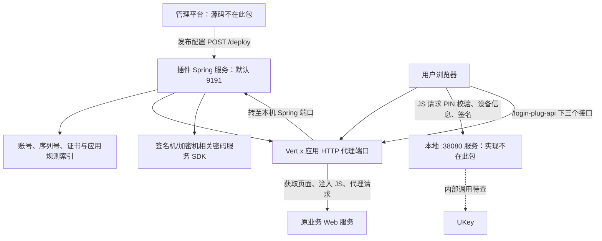
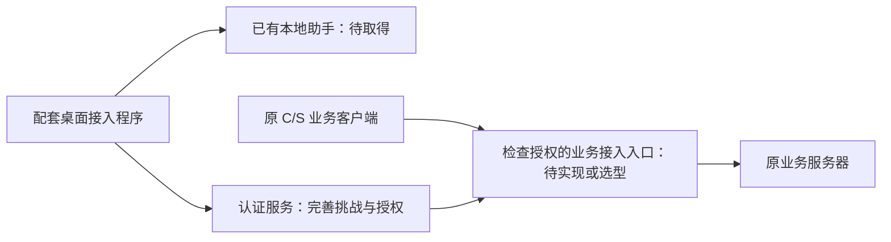

# ymnmr-master 源码与 UKey 接入分析

分析日期：2026-11-05。

后续实测：2026-11-06 已在本机成功构建启动并完成网页及接口验证。使用软件替身模拟助手和密码服务，确认正常调用流程，并复现未认证请求转发、签名重送、未签发原文验签及故障放行等行为。见[本地验证记录](/Users/chen/project/cs-ukey/docs/validation/web-ukey-local-validation-2026-11-06.md)。这不包含真实 UKey、SM2、CA 或客户现场验证；下文的“仅静态分析”描述适用于原始分析阶段。

## 1. 材料、检查范围与结论

用户提供的压缩包 SHA-256：`c053f88b1c2582a68e56ab5e9f07adede11af6f61e2e7312ac308490e4da1b3a`。

- [保留的 ZIP](/Users/chen/project/cs-ukey/artifacts/user-provided/2026-11-05/ymnmr-master.zip)
- [源码目录](/Users/chen/project/cs-ukey/artifacts/user-provided/2026-11-05/ymnmr-master)
- [来源、逐文件哈希](/Users/chen/project/cs-ukey/evidence/user-provided/2026-11-05/ymnmr-source/manifest.json)
- [静态检查记录](/Users/chen/project/cs-ukey/evidence/user-provided/2026-11-05/ymnmr-source/inspection-summary.json)
- [与上一份 JS 的差异](/Users/chen/project/cs-ukey/evidence/user-provided/2026-11-05/ymnmr-source/js-template-vs-previous.diff)

包内共 33 个文件，包括 24 个 Java 源文件（2,809 行）、一个 JS（1,530 行）及两个密码服务 SDK JAR。项目实际标识是 `ym-login-plug:1.1.5`，使用 Spring Boot WebFlux 和 Vert.x。

这是**服务器登录插件源码**，不是管理平台完整源码，也不是云密 UKey 助手源码。源码能够确认 HTTP 代理、页面注入、用户与证书映射、随机数和验签服务；没有提供原生 C/S 接入程序或通用 TCP/UDP/IP 隧道。

最重要的发现：本插件的代理转发链没有检查 UKey 认证授权状态；随机数没有在本插件内保存、过期或消费；验签接口返回布尔结果，没有建立可供后续业务请求核验的登录授权。这些是本源码范围内的缺口，不能直接据此认定客户现场没有额外控制措施。

本次进行了安全路径检查与原样解包、源码阅读、XML 解析、JS 语法检查、SDK 字节码静态反汇编。没有执行应用、SDK、部署脚本，没有连接真实 UKey、密码服务或业务服务器；没有进行完整 Maven 构建或现场运行验证。

## 2. 主要模块及职责

| 模块 | 作用 |
|---|---|
| `YmNMRApplication` | 启动服务，从运行目录的 `config/platformConfig.json` 恢复配置 |
| `ReactiveController` | 提供 `/deploy`、`/verifyUser`、`/genRandom`、`/verifySign` |
| `PlatformService` | 维护当前应用规则，建立“设备序列号/业务账号 → UKey 用户”的索引，查找证书 |
| `VertxEventListener` | 保存配置，启动或重新部署一个 Vert.x 代理实例 |
| `MainVerticle` | 建立应用代理端口，代理认证 API、获取登录页面并注入 JS、转发其他 HTTP 请求 |
| `ReactiveService` | 按配置复用或重建签名机/加密机客户端 |
| `SignMachineService` / `CryptMachineService` | 适配密码服务的 2.0、3.0 两种 SDK |
| `UkeyUser` | 描述设备序列号、业务账号、应用 ID 与预先配置的证书 |
| `DeployIpWhitelistFilter` | 只限制 `/deploy` 的来源地址 |
| `RateLimitFilter` | 限制三个认证 API 的请求频率，不是业务登录授权检查 |
| `ConfigEncryptor` | 使用 AES-GCM 加密保存配置，支持环境变量提供密钥材料 |

版本及依赖见 [pom.xml](/Users/chen/project/cs-ukey/artifacts/user-provided/2026-11-05/ymnmr-master/pom.xml:7)。源码目标版本为 Java 8；实际环境兼容性未通过构建或运行验证。

## 3. 已经能够确认的调用关系

JS 模板现在使用同源相对地址 `/login-plug-api`，并保留待替换的登录配置参数。Java 的 `loadJavaScript` 负责替换配置后包入 `<script>`，与上一份手工填入 IP、账号框、按钮规则的 JS 相比，业务逻辑基本一致。

关键位置：

- [代理路由和认证 API 转发](/Users/chen/project/cs-ukey/artifacts/user-provided/2026-11-05/ymnmr-master/src/main/java/com/ym/nmr/core/MainVerticle.java:218)
- [普通业务 HTTP 反向代理](/Users/chen/project/cs-ukey/artifacts/user-provided/2026-11-05/ymnmr-master/src/main/java/com/ym/nmr/core/MainVerticle.java:323)
- [登录页面获取与提交转发](/Users/chen/project/cs-ukey/artifacts/user-provided/2026-11-05/ymnmr-master/src/main/java/com/ym/nmr/core/MainVerticle.java:411)
- [JS 注入及模板替换](/Users/chen/project/cs-ukey/artifacts/user-provided/2026-11-05/ymnmr-master/src/main/java/com/ym/nmr/core/MainVerticle.java:550)

因此可以确认这套源码实现了网页反向代理式接入，但不能据此认定用户每个客户现场已按此部署；“有代理端口”也不能推导为“支持任意原生 C/S 协议”。

## 4. 四个服务端接口实际做了什么

### `/deploy`：更新配置与代理

接收完整 `PlatformConfig`，更新规则及 UKey 用户索引，发布事件保存配置并重建代理。来源限制来自 IP 白名单。包内 `application.properties` 实际配置为 `server.ips=127.0.0.1`，不是先前 PDF 样例中的 `*`；构造器的未配置默认值仍是 `*`。

当前代码只维护一个 `PlatformConfig`、一个配置文件、一个 `currentVertx`。再次部署会替换配置并关闭重建代理，而不是自动新增一个长期并行的应用代理。多应用部署方式需要额外明确。

### `/verifyUser`：判断账号是否在 UKey 配置中

检查账号字段规则，按精确、忽略大小写、前缀或后缀规则判断账号是否存在。它不是对业务账号密码做校验，也没有验证用户现在持有 UKey。

### `/genRandom`：检查序列号后返回随机文本

检查设备序列号是否在配置中，再调用 SDK 获取随机数。随后直接返回，没有在插件内记录：随机文本属于谁、何时签发、何时过期、是否已经使用，以及所属业务会话。

### `/verifySign`：按账号与序列号找到证书后验签

从请求读取 `signature`、`originalText`、`serialNumber`、`username`，查找配置里的证书，调用密码服务验签，最后返回文本 `true` 或 `false`。

**证书并不是从网页 `certInfo` 字段获取的。** 先前 JS 中该字段为空的问题，在这里得到了解释：证书从已发布的 `UkeyUser.ukeyCert` 获取。

账号绑定确实存在：先按序列号筛出候选，再在候选中匹配业务账号，不是只看设备序列号。前缀/后缀规则会扩大允许的账号集合，具体是否符合业务要求要看实际配置。

关键位置：[认证接口](/Users/chen/project/cs-ukey/artifacts/user-provided/2026-11-05/ymnmr-master/src/main/java/com/ym/nmr/controller/ReactiveController.java:52)、[账号与证书查找](/Users/chen/project/cs-ukey/artifacts/user-provided/2026-11-05/ymnmr-master/src/main/java/com/ym/nmr/service/PlatformService.java:102)、[账号匹配规则](/Users/chen/project/cs-ukey/artifacts/user-provided/2026-11-05/ymnmr-master/src/main/java/com/ym/nmr/model/UkeyUser.java:58)。

## 5. 对方案设计最重要的缺口

| 优先级 | 发现 | 证据与范围 |
|---|---|---|
| 高 | **代理没有在转发前检查 UKey 授权** | `configureReverseProxy` 注册 `/*` 直接进入 `ProxyHandler`；登录页处理也直接请求上游；没有认证状态检查。`verifySign` 只返回布尔文本，没有建立授权会话或票据 |
| 高 | **随机数没有形成一次性登录挑战** | 控制器生成后直接返回；验签接受调用方的 `originalText`，没有与已签发挑战比对，也没有有效期与消费逻辑。本插件没有拒绝旧原文/签名重送的显式状态机制 |
| 高 | **前端错误放行逻辑仍保留** | 包内 JS 与上一份核心逻辑相同：`verifyUser` 失败或账号框未匹配时继续原登录。前两项后端缺口使这些分支更值得优先验证 |
| 高 | **HTTPS 初始化失败时降级 HTTP** | `MainVerticle` 378—380 行捕获异常后新建普通 `HttpServerOptions` 并继续启动，违背“必须使用安全入口时失败应停止”的设计预期 |
| 高 | **上游 HTTPS 证书校验关闭** | `buildHttpClientOptions` 在 HTTPS 时设置 `setVerifyHost(false).setTrustAll(true)`，不能由“链路是 HTTPS”推导为已经验证了上游身份 |
| 待负向测试 | **V2 加密机验签 SDK 的成功条件可能过宽** | `CryptClient.verifySignSM2WithCert` 仅按响应 `errCode == 0` 返回 true，没有读取响应布尔数据。如服务用成功错误码携带 `mData=false` 表示验签不通过，会被此 SDK 判断为 true；服务端返回契约未提供，不能认定现场已经误验签 |

前两项是认证协议和访问控制层面的缺口，补一个桌面 PIN 界面不能解决。应先明确已有外部系统是否补充了强制访问控制；若没有，应在设计中补齐。

本源码中未见明确的证书链、有效期、吊销状态和用途检查。部分验签会交给外部密码服务，因此需要其接口契约与负向测试；不能只凭未在此包看到检查，就断言整个系统完全没有证书验证。

`sslType=1` 在这里用于尝试生成 SM2 自签证书。生成某类证书与完整实现并正确使用项目要求的国密通信协议是不同层面的证据；本次未验证协议协商、算法套件或证书链，不能把该配置项当作通信合规结论。

## 6. SDK 静态分析补充

使用系统 `javap 25.0.5 -p -c` 阅读包内 SDK 字节码，没有运行或初始化目标类。保存了六个反汇编文本，详见检查记录。

| 业务分支 | 实际调用 | 可以确认的内容 |
|---|---|---|
| V2 签名机验签 | `ClientV2.verify → SignClient.rawVerify(..., 3, false)` | SDK 组装验签请求并调用内部 `Client.send`；布尔参数控制是否先做 SM3 预处理，不能仅凭 `false` 推断它表示跳过证书检查 |
| V2 加密机验签 | `CryptMachineService.verify → CryptClient.verifySignWithCert` | 先处理证书、公钥和消息摘要，再通过 `getSM2VerifyWithCert` 发请求；不是仅凭方法名就认定本地软验签 |
| V3 验签 | `ClientV3.verify → CipherClient.rawVerify` | 将原文按 UTF-8 转 Base64，连同签名和证书交给 SDK 的密码服务请求 |
| 随机数 | V2/V3 `genRandom(32)` | 请求密码服务生成随机数据；没有因此自动获得登录挑战的生命周期管理 |

V2 包里两个 `.so` 都是 Netty 网络传输库，不是 SKF/UKey 设备库。此包未提供用户电脑上的设备驱动、助手 MSI 或助手实现。

V2 SDK 成功条件的证据在 [CryptClient 反汇编](/Users/chen/project/cs-ukey/evidence/user-provided/2026-11-05/ymnmr-source/ym_com_coc_client_CryptClient.javap.txt) 的 `verifySignSM2WithCert` 方法；它与 `SignClient.rawVerify` 返回完整布尔响应的路径需要分开测试。

## 7. 其他具体实现问题

- **限流注释与实现不同**：注释写 30 次/分钟，常量实际为 10 次/分钟，且三个 API 合并计数。一次正常认证通常要三个请求。经本机代理转发而没有可信真实来源信息时，多个用户可能共用一个来源计数，影响可用性。代码又直接采用请求里的 `X-Forwarded-For`，没有验证它来自可信代理。[限流代码](/Users/chen/project/cs-ukey/artifacts/user-provided/2026-11-05/ymnmr-master/src/main/java/com/ym/nmr/config/RateLimitFilter.java:32)
- **错误返回可能触发豁免**：限流导致 `/verifyUser` 返回 429 时，当前 JS 也会将其处理为无需 UKey。应将“明确豁免”与“服务不可用”分开。
- **配置加密存在固定默认密钥和旧格式回退**：未设置环境变量时使用源码内默认材料；AES 解密失败后还会尝试没有认证保护的旧编码格式。此机制不应被当成已完成可靠的配置密钥管理与防篡改证明。[配置工具](/Users/chen/project/cs-ukey/artifacts/user-provided/2026-11-05/ymnmr-master/src/main/java/com/ym/nmr/util/ConfigEncryptor.java:41)、[旧格式兼容](/Users/chen/project/cs-ukey/artifacts/user-provided/2026-11-05/ymnmr-master/src/main/java/com/ym/nmr/YmNMRApplication.java:96)
- **部署成功响应不等于代理已启动**：`/deploy` 返回成功时，没有等待所有异步保存、关闭和监听完成；参数无有效服务配置时也可能返回发布成功。实际成功条件需要收紧。
- **同路径接口响应可能被注入脚本**：`handleLoginPage` 没有先判断响应是否为 HTML；同一 URL 的 POST 如果返回 JSON，也可能被追加脚本，破坏响应。需要用实际业务响应验证。
- **跨域规则宽泛**：CORS 配置允许任意来源模式、方法、头并启用凭据。它不是登录认证，也不能替代服务端授权；实际允许的页面来源应明确。
- **调试日志包含敏感配置入口**：`deployPlatform` 会在 debug 输出整个配置请求体，可能包含密码服务访问凭据；报告不复述具体值。
- **此前 JS 的取消挂起、全局 5 秒放行、并发状态和 Request 对象重放问题仍存在**，参见先前 JS 分析。

没有进行依赖漏洞库扫描；此报告不对依赖版本给出未经验证的 CVE 结论。

## 8. 对 C/S 接入的具体影响

### 可以复用的部分

1. `PlatformConfig`、`UkeyUser` 的应用、设备、业务账号和证书配置模型。
2. V2/V3 密码服务适配、随机数获取及签名验证能力，但要补齐调用契约和负向验证。
3. 配置发布与恢复的框架，但需明确管理认证、完整性和实际密钥管理。
4. 本地助手接口可作为候选复用点；助手不在此包，尚未验证。

### 必须新增或明确的部分

1. **桌面端调用入口**：在不修改业务 EXE 的情况下，由配套接入程序对接本地助手和认证服务。先拿到助手接口，不必先重写 UKey 驱动或 SKF 库。
2. **完整的认证授权状态**：采用适合项目要求、经过确认的认证协议实现挑战与证明校验、身份和应用绑定、过期与撤销；不能直接把目前三个接口的调用顺序当作完整协议。
3. **服务端强制业务访问控制**：认证成功应与对应用户及连接/会话绑定，由受控入口检查后才转发。原业务连接路径也要受到策略约束，不能只认证后启动 EXE，或仅按电脑 IP 长时间放行。
4. **业务登录身份衔接**：UKey 认证通过后，原业务系统是否还需要账号密码、能否关联同一账号，需要单独确定。

现有 HTTP 代理不能直接当作通用 C/S 安全接入层：C/S 即使使用 HTTP，也不会自动执行注入 JS；私有 TCP、UDP、多端口依赖更需要对应的代理或通道能力。是否能继续扩展本项目，需要先取得一个代表性客户端的连接信息和现场允许的调整范围。

## 9. 下一步真正缺少的材料

不需要再泛问“网页端到底有没有服务端程序”，源码已经给出了具体答案。现在最有价值的是：

1. **云密 UKey 助手**安装包、接口文档，最好有对应源码；确认 38080 端口归属、接口访问限制及设备会话行为。
2. **现场实际版本和脱敏配置**：当前运行 JAR 是否就是 1.1.5，使用哪个入口、规则和账号匹配方式；是否另有服务端认证拦截或网络强制策略。
3. **一个代表性 C/S**：客户端类型/版本、操作系统、服务器地址与协议端口、原登录流程、已有认证接口，以及允许安装和网络调整的范围。

这些材料齐备后，可以比较 C/S 接入路线并制定试点；当前源码本身还不足以证明完整密码改造方案已经符合验收要求。
