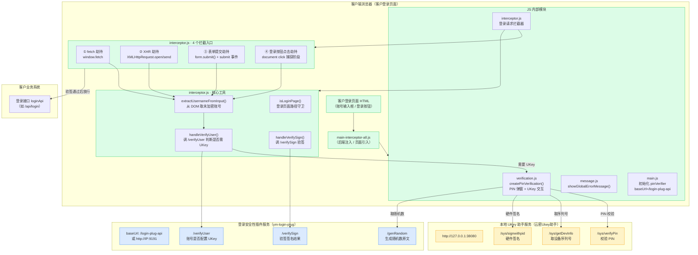
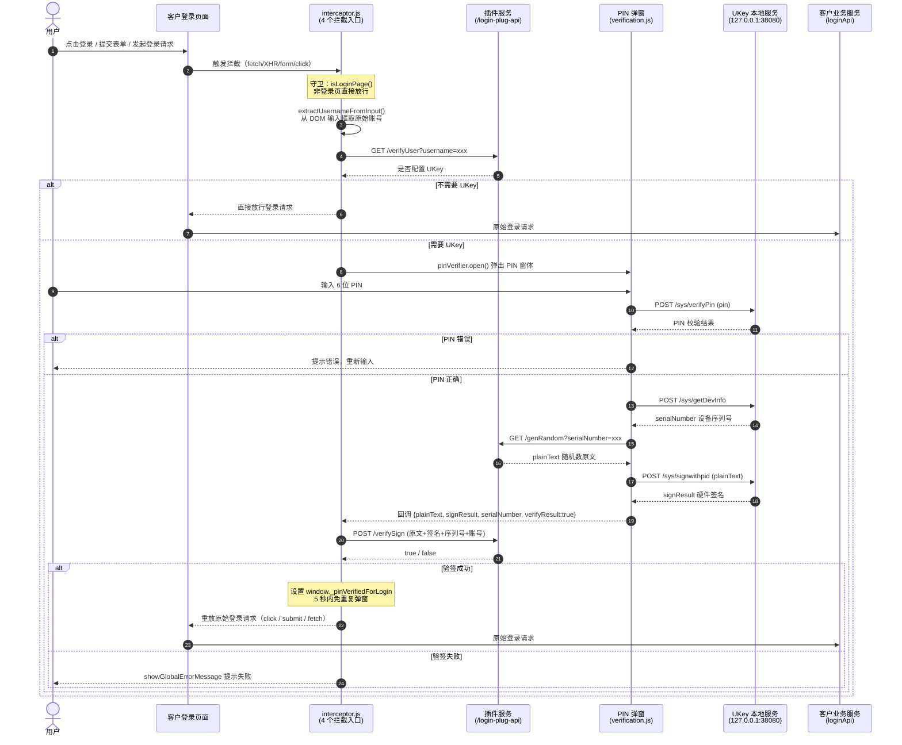

**插件拦截架构设计**

> 本文档基于 `src/main/resources/static/main-interceptor-all.js` 分析整理，描述登录安全性插件在客户端浏览器侧的拦截与 UKey 验签架构。

## 一、概述

`main-interceptor-all.js` 是登录安全性插件的前端一体化脚本，由以下 4 个模块合并而成：

| 模块 | 职责 |
|------|------|
| **message.js** | 全局错误 Toast 提示 |
| **verification.js** | PIN 验证弹窗 UI + UKey 本地服务通信 |
| **main.js** | 实例化 PIN 组件、设置插件服务 baseUrl |
| **interceptor.js** | 4 路登录请求拦截 + 验签流程编排 |

脚本由后端 `MainVerticle.loadJavaScript()` 注入（或由客户登录页面直接引入），并替换以下模板变量：

| 变量 | 说明 |
|------|------|
| `${loginApi}` | 客户登录接口路径 |
| `${loginField}` | 账号输入框匹配规则（`key=value&key=value`） |
| `${loginButton}` | 登录按钮匹配规则（属性格式或 CSS 选择器） |
| `${loginPagePaths}` | 登录页面路径列表（支持 hash 路由） |

---

## 二、系统组件架构图



---

## 三、登录拦截验签时序图



---

## 四、模块详细说明

### 4.1 message.js — 全局错误提示

提供 `showGlobalErrorMessage(message)` 函数，在页面右上角创建一个红色 Toast 提示，3 秒后自动消失。用于验签失败、网络异常等场景的用户反馈。

### 4.2 verification.js — PIN 验证与 UKey 签名

通过 `createPinVerification(options)` 工厂函数创建 PIN 验证组件，返回 `{ open, close, reset, setPin }` 公共 API。

**内部状态：**

| 变量 | 说明 |
|------|------|
| `serialNumber` | UKey 设备序列号 |
| `plainText` | 随机数原文 |
| `signResult` | 硬件签名结果 |
| `verifyResult` | 验签结果标志 |
| `certInfo` | 证书信息 |

**与 UKey 本地服务的交互（`http://127.0.0.1:38080`）：**

| 接口 | 方法 | 说明 |
|------|------|------|
| `/sys/verifyPin` | POST | 校验用户输入的 PIN |
| `/sys/getDevInfo` | POST | 获取 UKey 设备序列号 |
| `/sys/signwithpid` | POST | 使用 PIN 对原文进行硬件签名 |

**关键流程：**
1. `open(func)` — 打开 PIN 弹窗，传入验签完成回调
2. 用户输入 PIN → `verifyPinRemote(pin)` 校验
3. 校验通过 → `getDeviceInfoRemote()` 取序列号 → `getRandom()` 从插件服务取随机数
4. `signWithPinRemote()` 硬件签名 → 回调返回签名数据

### 4.3 main.js — 初始化

```js
const pinVerifier = createPinVerification({ pinLength: 6, ... });
pinVerifier.setPin("111111");
pinVerifier.baseUrl = "/login-plug-api";
```

### 4.4 interceptor.js — 登录请求拦截

#### 4.4.1 页面守卫 `isLoginPage()`

所有拦截入口均先调用 `isLoginPage()` 判断当前页面是否在 `loginPagePaths` 配置列表中，非登录页直接放行。支持 hash 路由（如 `/#/login`）。

#### 4.4.2 账号提取 `extractUsernameFromInput(scope)`

根据 `loginField` 配置的属性条件（如 `id=USERNAME`），从 DOM 输入框中读取**未加密的原始账号**。优先在按钮所在表单内查找，未命中再回退到整个文档。

#### 4.4.3 用户验证 `handleVerifyUser(username)`

调用插件服务 `/verifyUser?username=xxx`，判断该账号是否配置了 UKey 用户。未配置则直接放行登录。

#### 4.4.4 签名验证 `handleVerifySign(data)`

将原文、签名结果、序列号、账号发送到插件服务 `/verifySign`，由插件服务完成最终验签。返回 `{ success: true/false }`。

---

## 五、4 个拦截入口详解

所有拦截入口共用同一套验签流水线：**拦截 → 取账号 → /verifyUser 判断 → 弹 PIN → UKey 签名 → /verifySign 验签 → 放行原始请求**。

### 5.1 fetch 劫持

重写 `window.fetch`，通过 `isLoginApiUrl(url)` 精确匹配登录接口。匹配后走验签流程，通过后调用原始 `fetch` 发送请求。

### 5.2 XMLHttpRequest 劫持

重写 `XMLHttpRequest.prototype.open`（保存 URL）和 `send`（执行拦截）。验签通过后调用原始 `send` 发送请求。

### 5.3 表单提交劫持

- 重写 `HTMLFormElement.prototype.submit`（兼容老式系统 `form.submit()` 不触发 submit 事件的场景）
- 监听 `document` 的 `submit` 事件（捕获阶段）
- 通过 `loginSubmitTriggered` 标志区分"登录按钮提交"与"选择科室等其他提交"，仅登录按钮触发的提交才进行 PIN 验签

### 5.4 登录按钮点击劫持

监听 `document` 的 `click` 事件（捕获阶段），向上遍历 DOM 查找命中 `loginButton` 规则的元素。命中后阻止默认行为，走验签流程，通过后 `replayLoginClick(button)` 重放点击。

**按钮匹配规则：**
1. 属性格式 AND 匹配：`id=Logon&name=Logon&type=button`
2. CSS 选择器 OR 匹配：`#Logon, .btn-login`

---

## 六、关键设计要点

### 6.1 防重复弹窗

验签通过后设置 `window._pinVerifiedForLogin = true`，5 秒内同一登录请求不再重复弹窗，避免 fetch/XHR 与按钮点击双重拦截导致的重复验签。

### 6.2 动态 z-index

PIN 弹窗打开时动态计算页面最高 z-index 并 +10，确保弹窗始终覆盖在 Vue/React 框架加载层、Element-UI 消息等之上。

### 6.3 精确 URL 匹配

`isLoginApiUrl(url)` 将前端传入的相对/绝对/完整 URL 统一解析为绝对路径后与 `loginApi` 精确比较，避免误拦截非登录请求。

### 6.4 ESC / 取消处理

用户按 ESC 或点击取消关闭弹窗时，`verifyResult=false`，回调直接 `return`，不触发签名错误，避免递归报错。

### 6.5 登录页守卫

5 个拦截入口（fetch、XHR、form.submit、submit 事件、click 事件）均加 `isLoginPage()` 守卫，确保拦截只在登录页面生效，不影响业务系统其他页面。

---

## 七、外部服务依赖

| 服务 | 地址 | 接口 |
|------|------|------|
| **UKey 本地助手** | `http://127.0.0.1:38080` | `/sys/verifyPin`、`/sys/getDevInfo`、`/sys/signwithpid` |
| **插件服务** | `/login-plug-api`（Nginx 代理）或 `http://IP:9191` | `/verifyUser`、`/genRandom`、`/verifySign` |
| **客户业务系统** | 客户登录接口 `loginApi` | 原始登录请求（验签通过后放行） |
