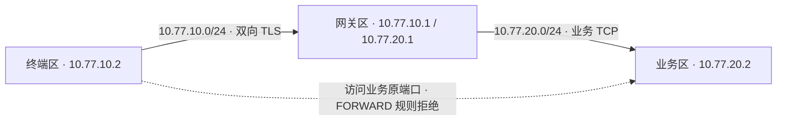

# C/S 隔离网络实验

在一台 Debian 虚拟机内建立三个 Linux 网络命名空间。终端运行 Agent 和 C/S 探针，接入区运行认证与转发服务，业务区运行独立的样例业务服务。



现有 DEMO 的监听器绑定回环地址。实验用 socat 把监听器接入虚拟链路，Agent 到接入服务之间的 TLS 字节由 socat 原样转发。业务端口通过网关自己的连接访问。终端直接访问业务原地址需要通过 Linux 转发链，因此可以明确检查防火墙的拒绝计数。

## 运行

在仓库根目录执行以下命令。Apple Silicon Mac 需要 Python 3.10+、Apple 命令行工具和能访问 Debian 官方仓库的网络。默认使用本仓库的 0.2.0 二进制解包目录，可以用 `--bundle` 指定同版本的解包目录。

```sh
python3 lab/network/run-mac.py --output tmp/network-lab-local
```

输出目录需要是尚未创建的新目录。首次运行下载约 266 MB 的 Debian arm64 镜像，使用固定版本和 SHA-512 校验。虚拟机使用 2 核、3 GiB 内存和一份临时磁盘。APT 在虚拟机内准备运行依赖，三个测试网络只通过虚拟网线互连。结果和日志写入 `share/results/`，虚拟机结束后可保留报告并删除该次临时磁盘。

已有一次性 Debian Linux 虚拟机时，也可以安装 `python3`、`openjdk-17-jre-headless`、`iproute2`、`iptables` 和 `socat`，复制 `guest.py` 及解包后的二进制目录，然后在虚拟机内以 root 执行以下命令。

```sh
python3 guest.py /opt/cs-lab /tmp/cs-lab-results
```

Linux 脚本创建本次运行专属的命名空间，配置虚拟网卡和转发链，结束后清理命名空间与自有子进程。测试私钥由每次运行生成并保存在虚拟机临时目录。

## 检查

1. 读取三个网络命名空间的 ID、地址和路由。
2. 短暂允许终端到原业务端口，确认合法业务账号可以直连。撤销临时规则后复测，检查网关拒绝计数增加。
3. 用受信 CA 签发但未登记的证书连接，检查接入服务返回 403。
4. 用已登记身份通过网关传输 2 MiB 二进制业务数据，检查身份、UTF-8 文本和二进制内容。
5. 在终端链路的两个方向施加 35 ms 延迟、10 ms 抖动和 1% 配置丢包，运行两条连接的负载，保存内核队列实际计数。
6. 对终端出方向施加 100% 丢包，保持已有业务连接，检查读超时。撤掉丢包规则后，检查原连接收到对应响应。
7. 链路恢复后，用新连接确认受控路径可用，重测原业务地址仍被阻断。

`network-result.json` 记录证据、各项结果及清理情况。实验范围是单台 Linux 虚拟机内的网络行为，业务协议和证书仍为 DEMO，报告字段 `physical_ukey` 和 `production_ready` 均为 false。同一终端中的进程共享 Agent 回环端口，真实 C/S 协议、Windows 终端和实体 UKey 需要各自的试点环境。

运行机制参考 [Apple Virtualization](https://developer.apple.com/documentation/virtualization/running-linux-in-a-virtual-machine)、[Debian 固定版本镜像](https://cloud.debian.org/images/cloud/bookworm/20261026-2643/) 和 [Linux tc-netem 手册](https://man7.org/linux/man-pages/man8/tc-netem.8.html)。
