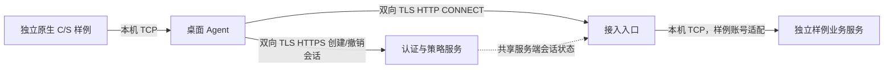

# 第一个可运行增量的技术边界

本工程沿用前期确定的终端/服务端分工与原配置中的账号、证书、应用资源关系。由于真实 UKey、助手接口、目标 C/S 和国密通道尚未确定，本增量没有自行拼接一套“随机数签名 + 布尔返回”的生产认证协议。

DEMO 使用 JDK JSSE 提供的标准 TLS 1.3 客户端证书认证，服务端另行管理应用授权会话。会话绑定到经 TLS 验证的证书指纹和资源，不是独立可用的 bearer 凭据。会话可以在有效期内建立多个获准连接；退出或过期后失效。

CONNECT 只承担应用层隧道封装，密码认证和加密交给 TLS。服务端把配置中的 CONNECT authority 映射到固定业务地址，不按客户端提供的任意主机名进行解析/转发。

提供四个 Java 模块：`common`、`access-server`、`desktop-agent`、`lab`。发行包中是四个 JAR 和多个独立启动入口，没有运行时第三方 JAR 依赖。测试依赖不打进运行包。

核心接口（均须双向 TLS）：

| 接口 | 行为 |
|---|---|
| `GET /api/status` | 验证证书登记并返回 DEMO 版本与身份 |
| `POST /api/sessions`，头 `X-Resource-Id` | 按资源授权创建有期限、与证书绑定的会话 |
| `DELETE /api/sessions/{id}` | 仅同一证书可撤销，关闭相应已登记连接 |
| TLS CONNECT，头 `X-Access-Session` | 再次验证证书、会话、资源及有效期后承接连接 |

元数据响应使用明确的 UTF-8 Java properties 格式，不是密码协议。会话凭据只保存在 Agent 内存，不写审计；所有客户端均验证服务端主机名。

真实设备实现需要能与已选认证/通道协议配合的密钥或身份接口。只有“本地助手能签任意文本”不意味着它可以直接替换 JSSE 的 TLS 私钥签名；必须按真实厂家接口和协议实现单独适配。`IdentityProvider` 当前只有软件演示实现。

REAL-PILOT 在加载软件密钥和绑定端口之前拒绝启动。未来也应核验通道、设备、证书信任/状态、业务路径和账号关联，禁止失败后回落为 DEMO。

本版本是进程和功能隔离的演示，未证明网络不可绕行、真实设备私钥保护或全部业务协议支持。相应限制见 README。

0.2.0 增加增强验证入口，见 [TESTING.md](TESTING.md)。转发层在单方向 EOF 时只关闭对端的发送方向，等待反向响应完成；强制撤销仍关闭整个连接。网关在 TLS 握手、CONNECT、样例首个 LOGIN 与上游建立阶段有总计 5 秒的绝对期限，避免通过持续少量发送数据无限占用建立中的连接；有效业务连接随后由会话期限约束。这些是本地 DEMO 的固定边界，不是已确定的现场超时参数。

实现依据：[JDK 17 JSSE 官方指南](https://docs.oracle.com/en/java/javase/17/security/java-secure-socket-extension-jsse-reference-guide.html)、[HttpsConfigurator 官方 API](https://docs.oracle.com/en/java/javase/17/docs/api/jdk.httpserver/com/sun/net/httpserver/HttpsConfigurator.html)。
